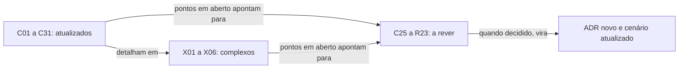

# Índice dos cenários

Todo cenário tem um diagrama Mermaid, as etapas e as falhas com a tratativa. Os arquivos estão em três pastas, de acordo com a situação.

| Pasta | Significado | Quantidade |
|---|---|---|
| [`atualizados/`](atualizados/) | Cenário já decidido e redesenhado no **modelo v1** (learners, gate, dois logs, prazos) | 31 |
| [`complexos/`](complexos/) | Assuntos que precisam de mais detalhe; cada um é referenciado pelos cenários que dependem dele | 6 |
| [`a_rever/`](a_rever/) | Cenários e hipóteses **ainda sem decisão**, com a proposta de fluxo e as perguntas em aberto | 14 |

**Legenda de status.** ✅ atualizado · ⚠️ proposta ainda não aprovada · 🟡 parcialmente tratado · ❓ sem resolução · 🆕 achado novo desta revisão.

## Atualizados (modelo v1)

| Id | Cenário | Ponto-chave |
|---|---|---|
| [C01](atualizados/C01-visao-geral.md) | Visão geral da arquitetura | Mapa das peças: clouds, células, link, roteamento externo |
| [C02](atualizados/C02-dentro-da-celula.md) | Dentro da célula: apps do cliente e DataReplication | Um `DataReplication` por célula, sem sidecar |
| [C03](atualizados/C03-escrita-strong.md) | Caminho feliz: escrita em modo Strong | Raft + gate + apply serial; ACK depois do apply na célula da líder |
| [C04](atualizados/C04-escrita-eventual.md) | Caminho feliz: escrita em modo Eventual | Apply paralelo; ACK só depois do gate Azure |
| [C05](atualizados/C05-leitura-strong-e-eventual.md) | Caminho feliz: leitura Strong e Eventual | Forte por padrão (ReadIndex); eventual local |
| [C06](atualizados/C06-follower-encaminha.md) | Requisição chega numa célula que não é a líder | Follower encaminha à líder, um salto |
| [C07](atualizados/C07-timeout-depois-do-commit.md) | Prazo estoura depois do commit, antes do ACK (retry do SDK) | `503 PENDING`, dedupe e versão condicional |
| [C08](atualizados/C08-queda-de-celula-lider-ou-az-aws.md) | Queda da célula líder ou de uma AZ na AWS | Eleição e reconstrução do gate |
| [C09](atualizados/C09-queda-de-az-azure.md) | Queda de uma AZ na Azure | Gate com 2 de 3; sem maioria vira C12 |
| [C10](atualizados/C10-celulas-de-app-aws-fora.md) | Apps da AWS fora, replicação viva: tráfego vai para a Azure | Escrita cruza o link duas vezes |
| [C11](atualizados/C11-transferencia-planejada.md) | Transferência planejada de liderança (manutenção) | Barreira e pausa curta, sem perda |
| [C12](atualizados/C12-modo-degradado.md) | Link AWS↔Azure cai ou Azure cai: modo degradado | `DEGRADE` depois de 2 s; header `x-dr-mode` |
| [C13](atualizados/C13-ressincronizacao-da-azure.md) | Ressincronização da Azure | Catch-up do log; `RESTORE` com barreira |
| [C14](atualizados/C14-aws-cai-sem-degradacao.md) | AWS cai por inteiro sem degradação prévia | Promoção humana, RPO 0 |
| [C15](atualizados/C15-aws-cai-em-degradacao.md) | AWS cai durante o modo degradado | Promoção humana, perda declarada (órfãs) |
| [C16](atualizados/C16-aws-volta-apos-promocao.md) | AWS volta depois da promoção da Azure | Learner com identidade nova; failback planejado |
| [C17](atualizados/C17-maquina-de-estados.md) | Máquina de estados dos modos de operação de um shard | Normal, degradado, ressincronizando, promovido |
| [C18](atualizados/C18-partida-e-recuperacao-do-no.md) | Partida, recuperação e parada limpa do nó | Ordem de partida e parada limpa |
| [C19](atualizados/C19-falha-do-datareplication.md) | O DataReplication da célula cai ou reinicia | Pod reinicia: recuperação dos dois logs |
| [C20](atualizados/C20-bypass-de-escrita-direta.md) | Aplicação escreve direto no banco (bypass) | Controle por IAM; detecção por auditoria |
| [C21](atualizados/C21-disco-fsync-e-reconstrucao.md) | Falha de fsync, corrupção, disco lento e disco perdido | Fsync fatal, identidade nova, `drctl rebuild` |
| [C22](atualizados/C22-cliente-com-sdk-nao-suportado.md) | Cliente com SDK ou versão não suportada | Rejeição por User-Agent depois do período de alerta |
| [C23](atualizados/C23-batchwriteitem-lote-uma-entrada.md) | BatchWriteItem: o lote é uma entrada e o apply é por item | Uma entrada; `PutItem`/`DeleteItem` condicionais por item (ADR-035) |
| [C24](atualizados/C24-orcamento-de-50ms-e-escrita-no-dynamodb.md) | Orçamento de 50 ms e a escrita no DynamoDB dentro do ACK | SLO exclui o banco; publicado como overhead + banco (ADR-036) |
| [C25](atualizados/C25-link-lento-faixa-cinzenta.md) | Link lento ou saturado (faixa cinzenta) | Só alerta; RPO continua 0 (ADR-037) |
| [C26](atualizados/C26-entrada-venenosa.md) | Entrada venenosa: um item que o banco recusa para sempre | Validação pré-commit; `SKIP` sempre por pessoa (ADR-038) |
| [C27](atualizados/C27-encaminhamento-sem-lider-conhecida.md) | Loop de encaminhamento e espera pela líder durante a eleição | Um salto, termo no encaminhamento; espera até 1 s e `503` (ADR-039) |
| [C28](atualizados/C28-leitura-eventual-na-azure-defasada.md) | Leitura eventual na Azure durante a degradação | Redireciona à AWS se possível, senão recusa (ADR-040) |
| [C29](atualizados/C29-disco-do-log-em-degradacao-longa.md) | Disco do log esgota durante uma degradação longa | Teto de 70% e reconstrução completa; sem S3 (ADR-041) |
| [C30](atualizados/C30-aws-que-volta-boot-cercado.md) | Fencing: o DynamoDB e o applier da AWS que voltam depois da promoção | Boot cercado, credenciais revogadas, célula recriada (ADR-042) |
| [C31](atualizados/C31-implantacao-por-cliente-e-identidade.md) | Uma instalação por cliente e identificação na API | 1 para 1; cliente pela configuração (ADR-043) |

## Complexos (detalhamento)

| Id | Assunto | Conteúdo |
|---|---|---|
| [X01](complexos/X01-gate-e-troca-de-lider.md) | Gate: definição, monotonicidade e troca de líder | Propriedades P1 a P8 do modelo TLA+ |
| [X02](complexos/X02-modo-degradado.md) | Modo degradado: entrada, permanência e saída | Entrada, permanência, saída e limiares |
| [X03](complexos/X03-desastre-e-promocao-da-azure.md) | Desastre: promoção da Azure, fencing e reconciliação | Epoch, escolha do log, órfãs, failback |
| [X04](complexos/X04-partida-recuperacao-e-dois-logs.md) | Partida, recuperação e coerência entre os dois logs | CommitPump e truncamento |
| [X05](complexos/X05-timeouts-e-idempotencia.md) | Timeouts em cascata e idempotência do retry | Prazos em cascata e janela de dedupe |
| [X06](complexos/X06-delete-ttl-gsi.md) | DELETE, TTL, Scan e GSI | Delete real, TTL local, GSI forte até propagar |

## A rever (em aberto)

| Id | Cenário | Situação e o que falta |
|---|---|---|
| [R03](a_rever/R03-backlog-de-apply-no-cosmos.md) | Backlog de apply no Cosmos (429 e RU insuficiente) | 🟡 parcialmente tratado: Cosmos lento pode encher disco do learner e degradar a AWS |
| [R06](a_rever/R06-duas-azs-aws-caem.md) | Duas AZs da AWS caem com a Azure saudável | ❓ sem resolução: método decidido, modelar a regra "degradar só com 3 de 3" no TLA+ e decidir com o resultado (liga na PEND-01) |
| [R07](a_rever/R07-link-oscilando.md) | Link oscilando (flapping) | ⚠️ proposta ainda não aprovada: Histerese, episódio com `fromIndex` estável |
| [R09](a_rever/R09-resincronizacao-lenta-ou-bloqueada.md) | Ressincronização da Azure lenta ou que nunca termina | 🟡 parcialmente tratado: ETA do catch-up; QoS; reconstrução |
| [R10](a_rever/R10-operador-lento-no-desastre.md) | Tempo de decisão humana no desastre | ❓ sem resolução: `drctl promote`, plantão, game days |
| [R11](a_rever/R11-api-de-promocao-depende-da-aws.md) | A API de promoção depende de algo que estava na AWS | 🟡 parcialmente tratado: Checklist de dependências; teste com AWS bloqueada |
| [R12](a_rever/R12-promocao-com-aws-viva.md) | Promoção da Azure com a AWS viva (split-brain, PEND-01) | ❓ sem resolução: PEND-01: com os outros arquitetos, não reabrir |
| [R13](a_rever/R13-escritas-orfas-reconciliacao.md) | Escritas órfãs: reconciliação depois da promoção (PEND-03) | ❓ sem resolução: PEND-03: extração e reaplicação com aprovação |
| [R16](a_rever/R16-leitura-forte-em-celulas-follower.md) | Leitura forte em células follower (ReadIndex) | ⚠️ proposta ainda não aprovada: ReadIndex em lote; Azure encaminha leitura forte |
| [R17](a_rever/R17-atributo-de-versao-e-limite-400kb.md) | Atributo de versão e o limite de 400 KB do item | ⚠️ proposta ainda não aprovada: Validar tamanho antes do commit; nome do atributo |
| [R18](a_rever/R18-rto-nao-quantificado.md) | RTO (Delta-T) ainda sem número | ❓ sem resolução: Medir eleição, gate, dedupe, replay, apply |
| [R20](a_rever/R20-custo-6x.md) | Custo: cada escrita lógica vira seis gravações | ⚠️ proposta ainda não aprovada: Volume e fórmula; faltam preços e RU medidas |
| [R22](a_rever/R22-memoria-da-janela-de-dedupe.md) | Memória da janela de dedupe | 🆕 achado novo desta revisão: **Novo.** ~58 MiB por shard; tabela mantida por todos os votantes |
| [R23](a_rever/R23-hipoteses-gerais.md) | Hipóteses gerais em aberto | ❓ sem resolução: H2/PEND-02 (bloqueante), H4, H7 a H11, H-DR1/4/6 |

## Como os cenários se conectam

Quando um item de `a_rever/` é decidido, ele passa para `atualizados/` (ou `complexos/`), ganha o ADR correspondente e a linha daqui muda.
