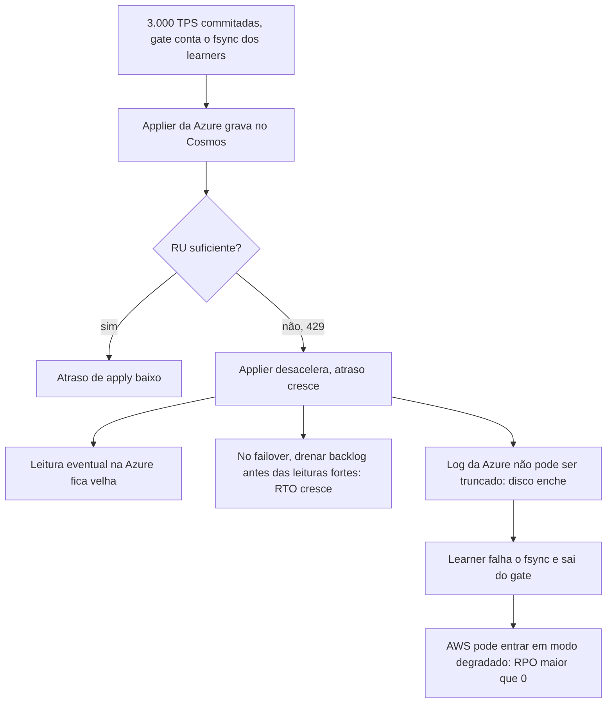

# R03 — Backlog de apply no Cosmos (429 e RU insuficiente)

**Status:** 🟡 A rever · parcialmente tratado · **ADRs:** [ADR-017](../../03_adr/ADR-017-azure-learners-e-gate.md), [ADR-018](../../03_adr/ADR-018-dois-logs-raft-e-replicacao.md), [ADR-023](../../03_adr/ADR-023-modos-de-escrita-e-leitura.md) · **Relacionados:** [C13](../atualizados/C13-ressincronizacao-da-azure.md), [C05](../atualizados/C05-leitura-strong-e-eventual.md), [X04](../complexos/X04-partida-recuperacao-e-dois-logs.md)

## Cenário

O gate conta o índice **durável (fsync)** nos learners da Azure, não o apply. Por isso, se o Cosmos não tiver RU para o pico e devolver 429, o **RPO segue 0**, mas o atraso entre `commitIndex` e `appliedIndex` na Azure cresce sem limite. Consequências: leituras eventuais na Azure ficam velhas ([C28](../atualizados/C28-leitura-eventual-na-azure-defasada.md)) e, no failover, a Azure precisa drenar o backlog antes de abrir leituras fortes, então **o RTO real depende do tamanho da fila**.

**Efeito escondido (novo).** O log de replicação da Azure só pode ser truncado até o que foi aplicado. Backlog longo **enche o disco dos learners**; learner sem disco falha o fsync, sai do gate e a AWS acaba em modo degradado. **Um Cosmos lento pode, por esse caminho, causar RPO > 0.**

## Diagrama: Do 429 ao RPO

## Fluxo proposto

1. Dimensionar RU para o pico **com folga de catch-up** (drenar mais rápido do que entra), com autoscale e teto de custo.
2. SLO de atraso de apply na Azure (por exemplo < 5 s) com alerta. Esse atraso é o **RTO escondido**.
3. Alerta de ocupação de disco dos learners com projeção de tempo até encher, ligado ao atraso de apply.
4. Teste periódico do tempo de drenagem de backlog (entra nos game days, [R10](R10-operador-lento-no-desastre.md)).
5. Contagem de RU por operação deve vir de teste com o Cloud-Adapter real: escrita condicional e itens de 2 KB têm custo diferente do exemplo de catálogo.

## Falhas e tratativas

- **Gate acoplado ao apply?.** Exigir que o apply da Azure esteja dentro de um limite para o gate liberar daria RPO e RTO previsíveis, mas amarraria o caminho de escrita da AWS ao desempenho do Cosmos. **Não recomendado**: o contrário (alerta e dimensionamento) mantém a AWS independente.
- **Entrada venenosa na Azure.** Produz o mesmo sintoma. Ver [C26](../atualizados/C26-entrada-venenosa.md).

## Pontos em aberto

- Meta de atraso de apply na Azure e dono do alerta (a definir com testes de RU).
- Política quando o disco do learner passa de um teto: pausar o recebimento (saindo do gate de forma controlada) ou continuar até o fsync falhar? **Recomendação:** saída controlada com alerta antes de falhar.
