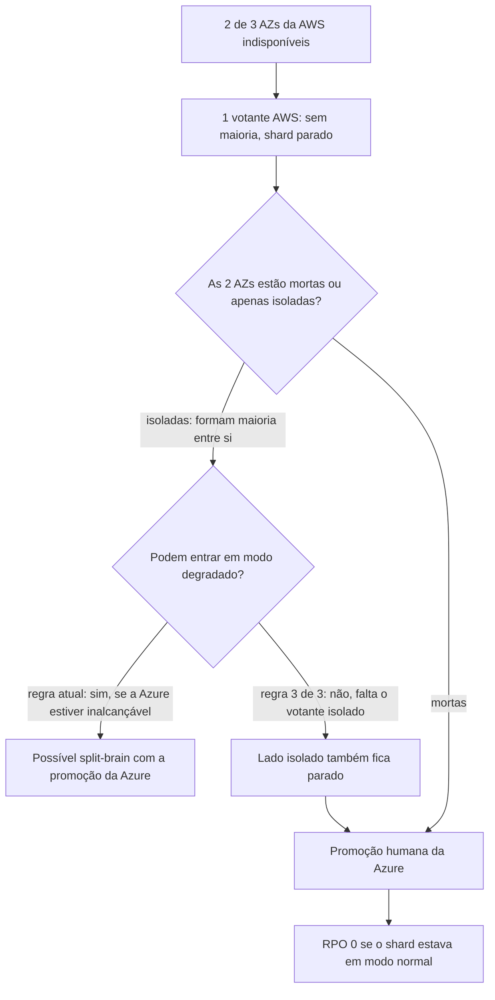

# R06 — Duas AZs da AWS caem com a Azure saudável

**Status:** ❓ A rever · método decidido em 13/10 (modelar no TLA+ e decidir com o resultado); regra ainda sem resolução · **ADRs:** [ADR-006](../../03_adr/ADR-006-consenso-por-shard-eleicao-na-aws.md), [ADR-033](../../03_adr/ADR-033-promocao-da-azure-humana.md), [ADR-014](../../03_adr/ADR-014-modo-degradado-opcao-b.md) · **Relacionados:** [C08](../atualizados/C08-queda-de-celula-lider-ou-az-aws.md), [X03](../complexos/X03-desastre-e-promocao-da-azure.md), [X01](../complexos/X01-gate-e-troca-de-lider.md)

## Cenário

Só os 3 votantes da AWS elegem a líder. Se duas AZs caem, resta um votante: sem maioria não há eleição nem commit, **mesmo com a Azure viva e completa**. A Azure não pode assumir sozinha, porque as duas AZs "caídas" podem estar apenas isoladas, eleger entre si (2 de 3), entrar em modo degradado e continuar aceitando escritas: seria split-brain.

Em modo **normal** o RPO é 0 (tudo que foi ACKado está na maioria Azure) e a retomada é a promoção humana ([X03](../complexos/X03-desastre-e-promocao-da-azure.md)). O problema é o **tempo** até alguém agir e o risco de a regra de segurança estar errada.

## Diagrama: Quem pode continuar

## Fluxo proposto

1. **Regra proposta: só entrar em modo degradado com 3 de 3 votantes AWS vivos.** Assim duas AZs isoladas nunca degradam sozinhas e a promoção da Azure nesse caso específico fica segura.
2. **Custo da regra:** uma falha dupla (uma AZ AWS fora **e** o link fora) passa a **parar** o shard em vez de degradar. É a escolha de preferir parar a perder dado, coerente com RPO 0, mas piora a disponibilidade num cenário de falha dupla.
3. Runbook de promoção com critérios objetivos de evidência: status oficial do provedor, alcance das AZs a partir de várias origens, visão do Compass-Router.
4. Antes de adotar a regra, incluí-la no **modelo TLA+** ([ADR-030](../../03_adr/ADR-030-verificacao-formal-tla.md)): propriedade "nunca dois lados aceitam escrita confirmada ao mesmo tempo".

## Falhas e tratativas

- **Quarto votante ou testemunha.** Uma testemunha (voto sem dado) em terceiro domínio resolveria o desempate, mas foi descartada ([ADR-008](../../03_adr/ADR-008-terceiro-dominio.md)) por exigir um terceiro provedor, fora da restrição de só AWS e Azure.
- **Sinal de falha.** Se o lado isolado tiver clientes ligados a ele, as escritas esperam e estouram o prazo; é falha explícita, não perda silenciosa.

## Pontos em aberto

- **Decidido pelo Bruno em 13/10:** modelar a regra "degradar só com 3 de 3 votantes AWS" no TLA+ e **decidir com o resultado** ([ADR-030](../../03_adr/ADR-030-verificacao-formal-tla.md)). A regra atual (degradar quando a Azure está inalcançável) é a comparação. A decisão final depende da PEND-01, que está com os outros arquitetos.
- O modelo precisa cobrir o caso de duas AZs isoladas que formam maioria entre si, para provar "nunca dois lados aceitam escrita confirmada ao mesmo tempo".
