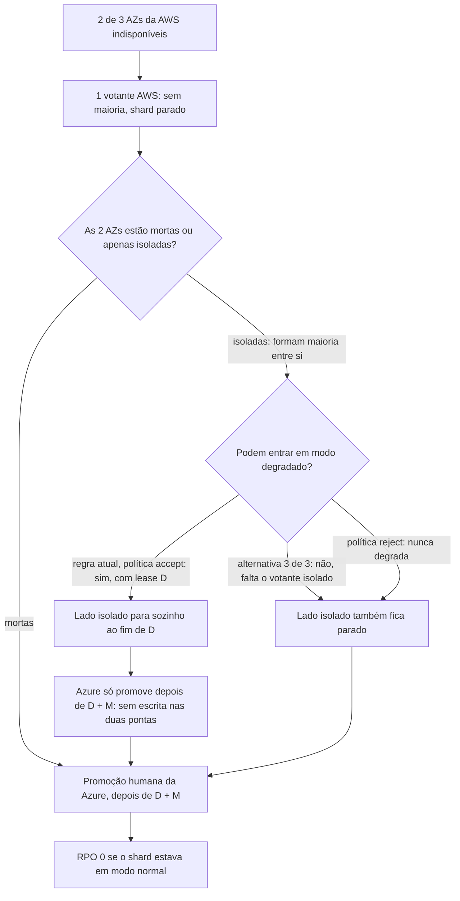

# R06 — Duas AZs da AWS caem com a Azure saudável

**Status:** 🟡 A rever · desenho decidido, falta D e prova no TLA+ (lease do [ADR-044](../../03_adr/ADR-044-lease-do-modo-degradado-e-promocao-da-azure.md), 13/10); a regra "degradar só com 3 de 3" fica como alternativa a comparar no modelo · **ADRs:** [ADR-006](../../03_adr/ADR-006-consenso-por-shard-eleicao-na-aws.md), [ADR-033](../../03_adr/ADR-033-promocao-da-azure-humana.md), [ADR-014](../../03_adr/ADR-014-modo-degradado-opcao-b.md), [ADR-044](../../03_adr/ADR-044-lease-do-modo-degradado-e-promocao-da-azure.md) · **Relacionados:** [C08](../atualizados/C08-queda-de-celula-lider-ou-az-aws.md), [C32](../atualizados/C32-particao-e-lease-do-modo-degradado.md), [X03](../complexos/X03-desastre-e-promocao-da-azure.md), [X01](../complexos/X01-gate-e-troca-de-lider.md)

## Cenário

Só os 3 votantes da AWS elegem a líder. Se duas AZs caem, resta um votante: sem maioria não há eleição nem commit, **mesmo com a Azure viva e completa**. A Azure não pode assumir sozinha, porque as duas AZs "caídas" podem estar apenas isoladas, eleger entre si (2 de 3), entrar em modo degradado e continuar aceitando escritas: seria split-brain.

Em modo **normal** o RPO é 0 (tudo que foi ACKado está na maioria Azure) e a retomada é a promoção humana ([X03](../complexos/X03-desastre-e-promocao-da-azure.md)). O problema é o **tempo** até alguém agir e o risco de a regra de segurança estar errada.

**O que o lease muda (13/10).** O caso das duas AZs isoladas que degradam entre si deixa de ser um split-brain aberto: o `DEGRADE` carrega um lease de duração D, e ao fim dele o lado isolado para sozinho (`503 LEASE_EXPIRED`). A Azure só pode ser promovida depois de D + M desde o último contato da AWS, e `ForcePromote` recusa antes disso. A promoção segue a mesma espera mesmo quando o shard estava em modo normal, porque a Azure não distingue "AWS morta" de "AWS isolada". O custo é o mesmo do ADR-044: o RTO desse desastre passa a ser pelo menos D + M quando a AWS estava degradada.

## Diagrama: Quem pode continuar

## Fluxo proposto

1. **Regra de base: lease (ADR-044).** O lado isolado que degrada tem validade finita D; a Azure espera D + M antes de promover. Isso é o que impede os dois lados de escrever ao mesmo tempo, sem exigir 3 de 3.
2. **Alternativa a comparar no modelo: só entrar em modo degradado com 3 de 3 votantes AWS vivos.** Assim duas AZs isoladas nunca degradam sozinhas. **Custo:** uma falha dupla (uma AZ AWS fora **e** o link fora) passa a **parar** o shard em vez de degradar; é preferir parar a perder dado, mas piora a disponibilidade num cenário de falha dupla. Com o lease, a regra 3 de 3 deixa de ser necessária para a segurança e passa a ser uma troca de disponibilidade por simplicidade, a decidir com o resultado do modelo.
3. **Instalações `reject`:** nunca degradam; o lado isolado também fica parado, e a promoção se apoia no fencing por maioria Azure ([ADR-045](../../03_adr/ADR-045-politica-de-degradacao-por-instalacao.md)).
4. Runbook de promoção com critérios objetivos de evidência: status oficial do provedor, alcance das AZs a partir de várias origens, visão do Compass-Router.
5. Incluir as duas regras no **modelo TLA+** ([ADR-030](../../03_adr/ADR-030-verificacao-formal-tla.md)): propriedade "nunca dois lados aceitam escrita confirmada ao mesmo tempo" (P11 em [X01](../complexos/X01-gate-e-troca-de-lider.md)).

## Falhas e tratativas

- **Quarto votante ou testemunha.** Uma testemunha (voto sem dado) em terceiro domínio resolveria o desempate, mas foi descartada ([ADR-008](../../03_adr/ADR-008-terceiro-dominio.md)) por exigir um terceiro provedor, fora da restrição de só AWS e Azure.
- **Sinal de falha.** Se o lado isolado tiver clientes ligados a ele, as escritas esperam e estouram o prazo; é falha explícita, não perda silenciosa.
- **O que conta como "contato da AWS".** Se a Azure ainda ouvir um votante AWS que não é líder, o prazo D + M é medido desde esse contato ou só desde o contato com a líder? A definição afeta o RTO e precisa constar do modelo (partição assimétrica, H-DR14 em [R23](R23-hipoteses-gerais.md)).

## Pontos em aberto

- Valor de D e de M (PEND-02) e a prova no TLA+ de que o lease sozinho basta nesse cenário; só então a regra 3 de 3 pode ser descartada. A decisão final depende da PEND-01 (desenho decidido, fecha com D e M aprovados e a prova).
- O modelo precisa cobrir o caso de duas AZs isoladas que formam maioria entre si, para provar "nunca dois lados aceitam escrita confirmada ao mesmo tempo", com e sem a regra 3 de 3.
