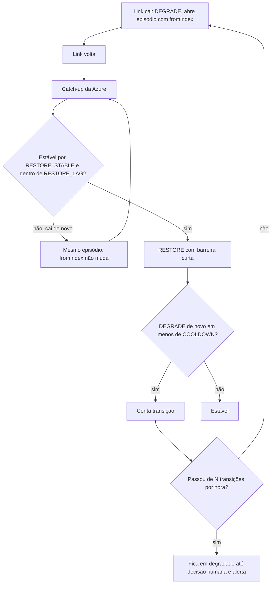

# R07 — Link oscilando (flapping)

**Status:** ⚠️ A rever · proposta ainda não aprovada · **ADRs:** [ADR-014](../../03_adr/ADR-014-modo-degradado-opcao-b.md), [ADR-028](../../03_adr/ADR-028-timeouts-em-cascata.md) · **Relacionados:** [C12](../atualizados/C12-modo-degradado.md), [C13](../atualizados/C13-ressincronizacao-da-azure.md), [X02](../complexos/X02-modo-degradado.md)

## Cenário

Se o link cai e volta várias vezes, o shard entra em degradado, começa a ressincronizar, volta a degradar e assim por diante. Cada degradação abre uma janela de RPO > 0, e cada religação do gate gera uma pausa curta nas escritas.

## Diagrama: Histerese e episódio

## Fluxo proposto

1. **Histerese de saída:** `RESTORE` só depois de os learners ficarem dentro de `RESTORE_LAG` por `RESTORE_STABLE` (por exemplo 60 s; valores a medir).
2. **Episódio de degradação:** enquanto o gate não voltar ao normal por tempo estável, o `fromIndex` do episódio **não muda**. Isso mantém definida a janela de RPO e o conjunto de órfãs ([R13](R13-escritas-orfas-reconciliacao.md)).
3. **Contador de transições** por hora (`degraded_transitions`); acima de um limite, o shard fica degradado até decisão humana.
4. **Tempo mínimo em degradado** (`MIN_DEGRADED`) para evitar entrar e sair em segundos.

## Falhas e tratativas

- **Histerese longa demais.** Quanto maior a histerese, mais tempo com RPO > 0 depois que o link já voltou. É escolha entre estabilidade e janela de risco; valores saem do spike de link.

## Pontos em aberto

- Valores de `RESTORE_STABLE`, `RESTORE_LAG`, `COOLDOWN` e limite de transições (PEND-12).
