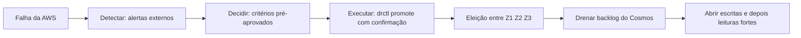

# R10 — Tempo de decisão humana no desastre

**Status:** ❓ A rever · sem resolução · **ADRs:** [ADR-033](../../03_adr/ADR-033-promocao-da-azure-humana.md) · **Relacionados:** [C14](../atualizados/C14-aws-cai-sem-degradacao.md), [X03](../complexos/X03-desastre-e-promocao-da-azure.md)

## Cenário

Como a promoção da Azure é sempre humana (ADR-033), o RTO inclui **perceber, decidir e executar**. Sem plantão e critérios pré-aprovados, isso pode levar horas. O RTO do projeto é `Delta-T` e ainda não tem número ([R18](R18-rto-nao-quantificado.md)).

## Diagrama: Linha do tempo do RTO com promoção

## Fluxo proposto

1. **Plantão 24x7** com runbook e critérios de decisão aprovados antes pelo negócio.
2. **Promoção manual automatizada:** um único comando (`drctl promote`) que faz toda a sequência depois da confirmação humana, com pré-checagens e registro de auditoria.
3. **Game days** periódicos medindo o tempo real de cada etapa.
4. Sinais externos independentes da AWS (monitoramento sintético a partir da Azure e de fora, status do provedor).

## Falhas e tratativas

- **Decisão tardia.** Sem limite de tempo, a decisão vira "esperar mais um pouco". Definir um prazo após o qual o plantão decide com a evidência disponível.

## Pontos em aberto

- Quem tem autoridade de decidir a promoção e qual o tempo máximo de decisão. **Depende da PEND-01** (outros arquitetos).
