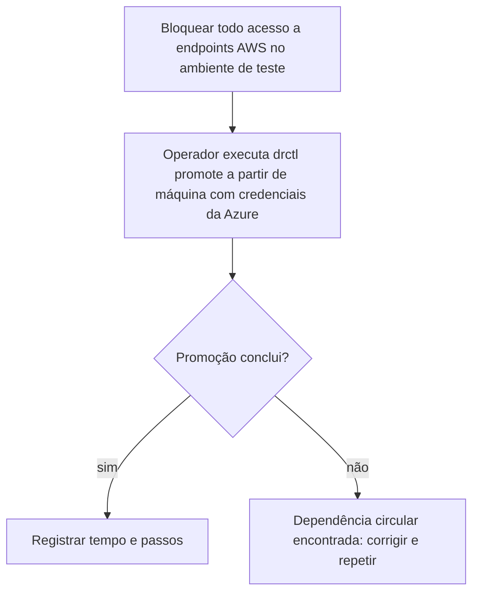

# R11 — A API de promoção depende de algo que estava na AWS

**Status:** 🟡 A rever · parcialmente tratado · **ADRs:** [ADR-033](../../03_adr/ADR-033-promocao-da-azure-humana.md) · **Relacionados:** [C14](../atualizados/C14-aws-cai-sem-degradacao.md), [X03](../complexos/X03-desastre-e-promocao-da-azure.md), [C18](../atualizados/C18-partida-e-recuperacao-do-no.md)

## Cenário

Se credenciais, segredos, imagens, pipeline ou DNS usados pelo `ForcePromote` estiverem na AWS, não é possível promover a Azure quando a AWS cai. O princípio ("sem dependência circular de uma cloud perdida") já está nos controles essenciais; **falta verificar item a item** e testar com a AWS totalmente bloqueada.

## Diagrama: Teste com a AWS bloqueada

## Checklist de dependências a eliminar ou duplicar na Azure

- imagens de contêiner (ECR x ACR) e o registro usado pelo AKS;
- segredos e chaves (Secrets Manager x Key Vault), incluindo as chaves de assinatura do manifesto;
- autoridade de certificados do mTLS entre células;
- DNS e roteamento (Route 53 x Azure DNS), Compass-Router e Agent (dependência externa, já confirmada nas duas clouds);
- repositório e pipeline que aplicam manifests (GitOps hospedado na AWS?);
- federação de identidade (IAM x Entra ID) e acesso do operador ao console da Azure;
- observabilidade e alertas: se o painel está na AWS, o operador fica cego no desastre.

## Pontos em aberto

- Inventário real das dependências por componente (dono: time de plataforma) e data do primeiro teste com a AWS bloqueada.
