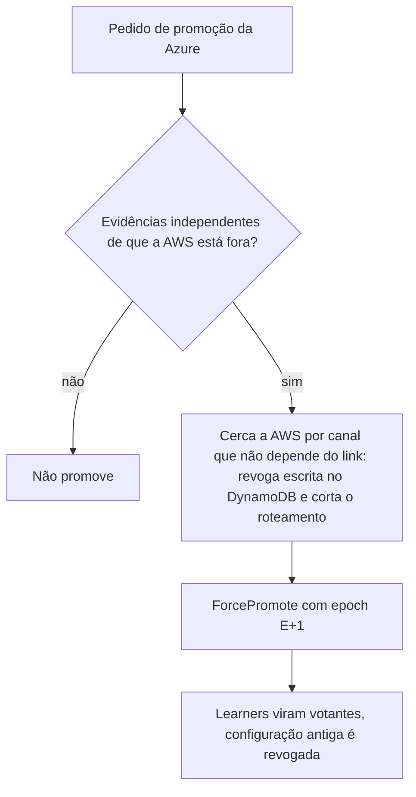

# R12 — Promoção da Azure com a AWS viva (split-brain, PEND-01)

**Status:** ❓ A rever · sem resolução · **ADRs:** [ADR-033](../../03_adr/ADR-033-promocao-da-azure-humana.md), [ADR-014](../../03_adr/ADR-014-modo-degradado-opcao-b.md) · **Relacionados:** [C14](../atualizados/C14-aws-cai-sem-degradacao.md), [X03](../complexos/X03-desastre-e-promocao-da-azure.md), [ADR-033](../../03_adr/ADR-033-promocao-da-azure-humana.md)

## Cenário

Com a opção B, a AWS segue escrevendo em modo degradado quando não alcança a Azure. Da Azure, "AWS morta" e "link caído" parecem iguais. Se a Azure for promovida com a AWS viva e isolada, **os dois lados confirmam escritas ao mesmo tempo**.

**Status:** em discussão com os outros arquitetos. Padrão atual: **promoção só por pessoa**. Este item **não deve ser reaberto sem a resposta do Bruno**; o texto abaixo só registra o risco e as mitigações já levantadas.

## Diagrama: Defesa em profundidade na promoção

## Fluxo proposto

1. Checklist de evidências: status oficial do provedor, alcance da AWS a partir de várias origens externas, visão do Compass-Router.
2. Cercar a AWS antes de promover (revogar credenciais de escrita da AWS pelo console do provedor, desativar o roteamento para as células AWS).
3. Restringir a entrada em modo degradado ([R06](R06-duas-azs-aws-caem.md)) reduz a janela de conflito.

## Pontos em aberto

- **Sem resolução.** Aguardando resposta dos outros arquitetos (PEND-01). Não reabrir.
