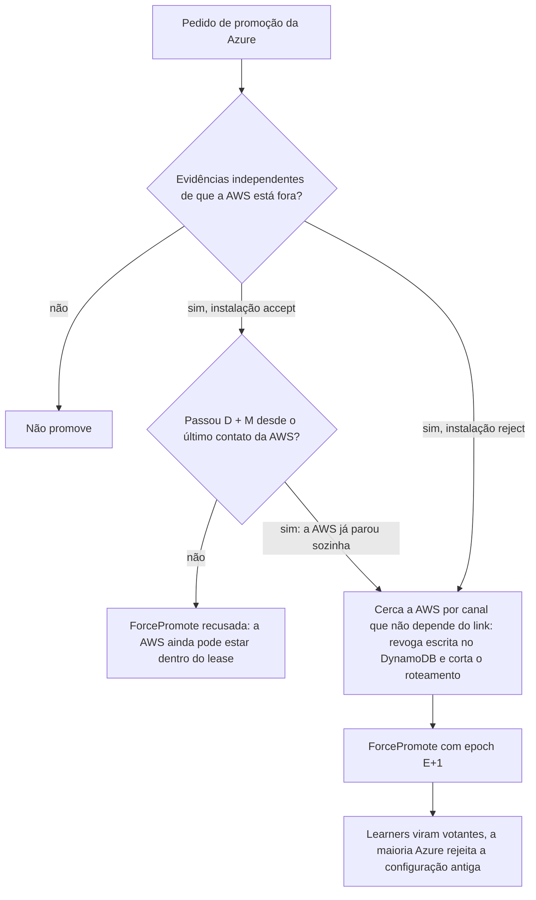

# R12 — Promoção da Azure com a AWS viva (split-brain, PEND-01)

**Status:** 🟡 A rever · desenho decidido, falta D e prova no TLA+ (lease e promoção depois de D + M, [ADR-044](../../03_adr/ADR-044-lease-do-modo-degradado-e-promocao-da-azure.md), 13/10) · **ADRs:** [ADR-044](../../03_adr/ADR-044-lease-do-modo-degradado-e-promocao-da-azure.md), [ADR-045](../../03_adr/ADR-045-politica-de-degradacao-por-instalacao.md), [ADR-033](../../03_adr/ADR-033-promocao-da-azure-humana.md), [ADR-014](../../03_adr/ADR-014-modo-degradado-opcao-b.md), [ADR-042](../../03_adr/ADR-042-aws-que-volta-boot-cercado-e-recriacao-da-celula.md) · **Relacionados:** [C14](../atualizados/C14-aws-cai-sem-degradacao.md), [C32](../atualizados/C32-particao-e-lease-do-modo-degradado.md), [X03](../complexos/X03-desastre-e-promocao-da-azure.md), [X02](../complexos/X02-modo-degradado.md)

## Cenário

Com a opção B, a AWS segue escrevendo em modo degradado quando não alcança a Azure. Da Azure, "AWS morta" e "link caído" parecem iguais. Se a Azure for promovida com a AWS viva e isolada, **os dois lados confirmam escritas ao mesmo tempo**. O conflito nasce da opção B: revogar credenciais e checar a epoch no boot não o impedem, porque a AWS antiga não sabe que foi substituída.

**O desenho decidido em 13/10 ([ADR-044](../../03_adr/ADR-044-lease-do-modo-degradado-e-promocao-da-azure.md)):** sem terceiro domínio ([ADR-008](../../03_adr/ADR-008-terceiro-dominio.md)), a saída é tempo e não consenso. A entrada `DEGRADE` tem validade D; ao fim dela a AWS para de aceitar escrita sozinha (`503 LEASE_EXPIRED`); a Azure só pode ser promovida depois de D + M desde o último contato da AWS, e `ForcePromote` recusa antes disso. Com `DEGRADED_POLICY=reject` não há degradação e a segurança vem do fencing por maioria Azure. A promoção **continua só por pessoa**; a promoção automática está com os outros arquitetos e **não deve ser reaberta sem a resposta do Bruno**.

O que falta: aprovar D e M (PEND-02) e provar no TLA+ que nunca há escrita confirmada nas duas pontas, inclusive a interação entre prorrogação do lease e promoção (H-DR13) e a partição assimétrica (H-DR14), em [R23](R23-hipoteses-gerais.md).

## Diagrama: Defesa em profundidade na promoção

## Fluxo proposto

1. Checklist de evidências: status oficial do provedor, alcance da AWS a partir de várias origens externas, visão do Compass-Router.
2. **Esperar o lease:** a API `ForcePromote` recusa antes de D + M (`accept`). Esta é a barreira de segurança; a evidência e o cerco não a substituem.
3. Cercar a AWS antes de promover (revogar credenciais de escrita da AWS pelo console do provedor, desativar o roteamento para as células AWS). Continua necessário para o retorno da célula ([ADR-042](../../03_adr/ADR-042-aws-que-volta-boot-cercado-e-recriacao-da-celula.md), [C30](../atualizados/C30-aws-que-volta-boot-cercado.md)), mas sozinho não impede a escrita da AWS isolada.
4. Restringir a entrada em modo degradado ([R06](R06-duas-azs-aws-caem.md)) reduz a janela de conflito; `DEGRADED_POLICY=reject` a elimina para o cliente que a escolher.

## Falhas e tratativas

- **Prorrogação do lease depois de a Azure já poder ser promovida.** Reabre o risco (H-DR13): a regra (por exemplo, marcar a Azure como `promotion_blocked` antes de prorrogar) fica para o modelo.
- **Pausa de processo ou deriva de relógio.** M inclui a deriva máxima e a pausa máxima de processo, e a AWS confere o lease a cada ACK.
- **RTO.** Se a AWS morre de verdade em modo degradado, o RTO é pelo menos D + M ([R18](R18-rto-nao-quantificado.md)).

## Pontos em aberto

- Valores de D e M e o aceite do negócio (PEND-02).
- O lease conta desde o último contato com a maioria Azure (`t_c`) e M não inclui `DEGRADE_AFTER` ([ADR-044](../../03_adr/ADR-044-lease-do-modo-degradado-e-promocao-da-azure.md)). Contorno de emergência (break-glass) da recusa do `ForcePromote`: decidido em 13/10 (15b), não existe na v1.
- Prova no TLA+ (P11 e P12 em [X01](../complexos/X01-gate-e-troca-de-lider.md)). A PEND-01 fecha quando D e M forem aprovados e o modelo provar a ausência de escrita nas duas pontas.
