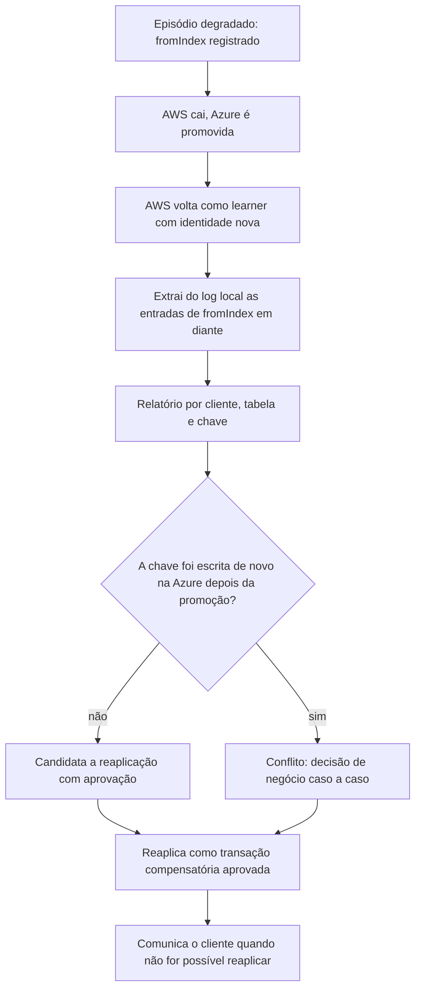

# R13 — Escritas órfãs: reconciliação depois da promoção (PEND-03)

**Status:** ❓ A rever · sem resolução · **ADRs:** [ADR-014](../../03_adr/ADR-014-modo-degradado-opcao-b.md), [ADR-033](../../03_adr/ADR-033-promocao-da-azure-humana.md) · **Relacionados:** [C15](../atualizados/C15-aws-cai-em-degradacao.md), [C16](../atualizados/C16-aws-volta-apos-promocao.md), [X03](../complexos/X03-desastre-e-promocao-da-azure.md)

## Cenário

Se a AWS cai **durante o modo degradado**, as escritas que ela confirmou ao cliente desde `fromIndex` e que não chegaram à Azure se perdem na promoção. Se a AWS volta, essas escritas "reaparecem" no log e no DynamoDB local, e alguém precisa decidir o que fazer com elas. Não há processo definido.

Elas **não** são perdidas pelo sistema de forma silenciosa: ficam no log da AWS (quando o disco sobrevive) e foram ACKadas com `x-dr-mode: degraded`, ou seja, o cliente foi avisado de que aquele ACK não tinha a garantia de RPO 0.

## Diagrama: Do episódio degradado ao relatório

## Fluxo proposto

1. Ferramenta `drctl orphans export` lê o log local da AWS a partir do `fromIndex` do **último episódio** ([R07](R07-link-oscilando.md): o `fromIndex` é estável durante o episódio) e gera relatório com chave, valor e índice.
2. Comparar com o estado atual da Azure por chave para separar "sem conflito" de "conflito".
3. A reaplicação é **sempre decidida por pessoa**, nunca automática, e entra no log como escrita nova e auditada.
4. Os clientes podem ajudar: cada ACK degradado vem com cabeçalho, então a aplicação pode registrar esses ACKs para cruzar depois.

## Falhas e tratativas

- **Disco da AWS perdido.** Se o volume do log da AWS não sobrevive, as órfãs são irrecuperáveis. O relatório depende do disco; vale a pena avaliar cópia periódica do log degradado para fora do volume ([C29](../atualizados/C29-disco-do-log-em-degradacao-longa.md)). Isso reduz a perda, não elimina.
- **DynamoDB com órfãs.** Mesmo sem o log, o DynamoDB local contém o resultado das órfãs aplicadas antes da queda ([C30](../atualizados/C30-aws-que-volta-boot-cercado.md)).

## Pontos em aberto

- Dono do processo (negócio ou plataforma) e política de comunicação ao cliente. Liga com o aceite do RPO > 0 (PEND-02, [R23](R23-hipoteses-gerais.md)).
