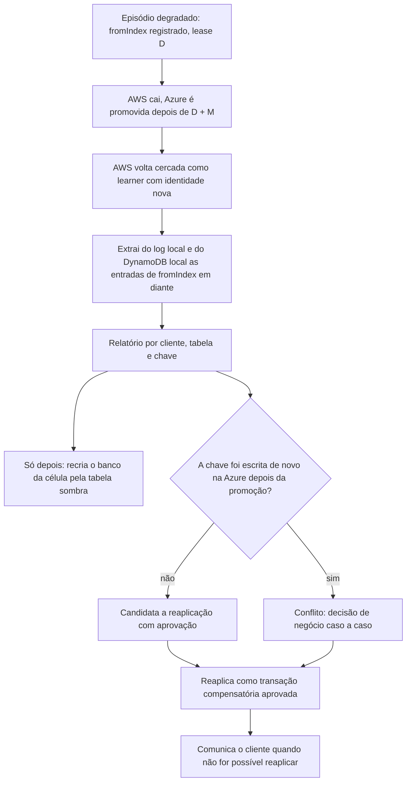

# R13 — Escritas órfãs: reconciliação depois da promoção (PEND-03)

**Status:** 🟡 A rever · janela das órfãs agora limitada por D ([ADR-044](../../03_adr/ADR-044-lease-do-modo-degradado-e-promocao-da-azure.md)) e ordem fixada com a recriação do banco ([ADR-042](../../03_adr/ADR-042-aws-que-volta-boot-cercado-e-recriacao-da-celula.md), [C33](../atualizados/C33-reconstrucao-em-tabela-sombra.md)); falta dono do processo, política com o cliente e o aceite do negócio · **ADRs:** [ADR-014](../../03_adr/ADR-014-modo-degradado-opcao-b.md), [ADR-033](../../03_adr/ADR-033-promocao-da-azure-humana.md), [ADR-042](../../03_adr/ADR-042-aws-que-volta-boot-cercado-e-recriacao-da-celula.md), [ADR-044](../../03_adr/ADR-044-lease-do-modo-degradado-e-promocao-da-azure.md) · **Relacionados:** [C15](../atualizados/C15-aws-cai-em-degradacao.md), [C16](../atualizados/C16-aws-volta-apos-promocao.md), [C30](../atualizados/C30-aws-que-volta-boot-cercado.md), [C33](../atualizados/C33-reconstrucao-em-tabela-sombra.md), [X03](../complexos/X03-desastre-e-promocao-da-azure.md)

## Cenário

Se a AWS cai **durante o modo degradado**, as escritas que ela confirmou ao cliente desde `fromIndex` e que não chegaram à Azure se perdem na promoção. Se a AWS volta, essas escritas "reaparecem" no log e no DynamoDB local, e alguém precisa decidir o que fazer com elas. Não há processo definido de decisão.

Elas **não** são perdidas pelo sistema de forma silenciosa: ficam no log da AWS (quando o disco sobrevive) e foram ACKadas com `x-dr-mode: degraded`, ou seja, o cliente foi avisado de que aquele ACK não tinha a garantia de RPO 0.

**O que mudou em 13/10.** O modo degradado tem lease: a AWS só ACKa escrita sem a Azure enquanto o lease D vale, e só uma pessoa o prorroga (`RENEW`). O conjunto de órfãs de um episódio fica, portanto, limitado em duração por D mais as prorrogações aprovadas, e o negócio aprova esse teto de forma explícita (PEND-02). Em instalações com `DEGRADED_POLICY=reject` não há órfãs: nada é ACKado sem a Azure.

**Ordem que importa.** Na volta da AWS, o DynamoDB da célula é recriado a partir da réplica ([ADR-042](../../03_adr/ADR-042-aws-que-volta-boot-cercado-e-recriacao-da-celula.md), recriação em tabela sombra pelo protocolo do [C33](../atualizados/C33-reconstrucao-em-tabela-sombra.md)), e **recriar o banco apaga as órfãs**. A extração do log e do banco local tem de acontecer **antes** do cutover, com aprovação humana e o PITR como rede de segurança.

## Diagrama: Do episódio degradado ao relatório

## Fluxo proposto

1. Ferramenta `drctl orphans export` lê o log local da AWS a partir do `fromIndex` do **último episódio** ([R07](R07-link-oscilando.md): o `fromIndex` é estável durante o episódio) e gera relatório com chave, valor e índice. Roda com a célula cercada (appliers desligados, [C30](../atualizados/C30-aws-que-volta-boot-cercado.md)) e **antes** da recriação do banco.
2. Comparar com o estado atual da Azure por chave para separar "sem conflito" de "conflito".
3. A reaplicação é **sempre decidida por pessoa**, nunca automática, e entra no log como escrita nova e auditada.
4. Os clientes podem ajudar: cada ACK degradado vem com cabeçalho, então a aplicação pode registrar esses ACKs para cruzar depois.
5. A reconciliação dirigida das chaves órfãs (sem recriar o banco inteiro) fica fora da v1 ([ADR-042](../../03_adr/ADR-042-aws-que-volta-boot-cercado-e-recriacao-da-celula.md)).

## Falhas e tratativas

- **Disco da AWS perdido.** Se o volume do log da AWS não sobrevive, as órfãs são irrecuperáveis. O relatório depende do disco; vale a pena avaliar cópia periódica do log degradado para fora do volume ([C29](../atualizados/C29-disco-do-log-em-degradacao-longa.md)). Isso reduz a perda, não elimina.
- **DynamoDB com órfãs.** Mesmo sem o log, o DynamoDB local contém o resultado das órfãs aplicadas antes da queda ([C30](../atualizados/C30-aws-que-volta-boot-cercado.md)); por isso a recriação do banco só acontece depois da extração e do PITR.
- **Órfã que a Azure já substituiu.** Se a chave foi escrita de novo depois da promoção, vira conflito de negócio; a versão do apply (`v < índice`) não decide isso, e reaplicar uma órfã por cima do dado novo exige a decisão humana.

## Pontos em aberto

- Dono do processo (negócio ou plataforma) e política de comunicação ao cliente. Liga com o aceite do RPO > 0 e do valor de D (PEND-02, [R23](R23-hipoteses-gerais.md)).
