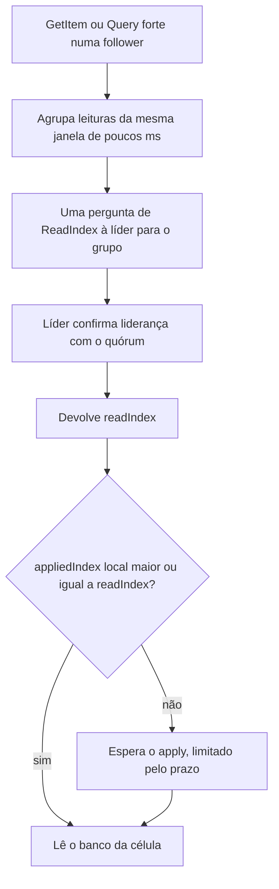

# R16 — Leitura forte em células follower (ReadIndex)

**Status:** ⚠️ A rever · proposta ainda não aprovada · **ADRs:** [ADR-023](../../03_adr/ADR-023-modos-de-escrita-e-leitura.md), [ADR-025](../../03_adr/ADR-025-escopo-da-api-v1-e-sdks.md) · **Relacionados:** [C05](../atualizados/C05-leitura-strong-e-eventual.md), [C06](../atualizados/C06-follower-encaminha.md)

## Cenário

O padrão de leitura é **forte** (`READ_MODE_DEFAULT`, e `ConsistentRead=true` sempre é forte). Numa célula follower, uma leitura forte precisa (1) perguntar à líder o `readIndex` (confirmando que ela ainda é líder), (2) esperar o apply local alcançar esse índice e (3) só então ler o banco da própria célula. Todas as leituras do shard passam pela líder para (1), e o custo soma ~1 RTT ao caminho da leitura.

## Diagrama: Caminho da leitura forte

## Fluxo proposto

1. **Agrupar (batch) pedidos de ReadIndex:** um round-trip serve a muitas leituras. O custo na líder passa a ser por lote, não por leitura.
2. **Leitura forte em célula Azure:** soma o RTT do link e depende do apply do Cosmos ([R03](R03-backlog-de-apply-no-cosmos.md)). Se o atraso passar de um limite, encaminhar a leitura forte a uma célula AWS (limite de 3 s) em vez de esperar.
3. **Leituras por lease** ficam desligadas por padrão (dependência de relógio, H9); só se o ReadIndex em lote não for suficiente.
4. **Métricas:** `read_index_wait`, `apply_wait` e fila na líder, por célula.

## Falhas e tratativas

- **Líder como gargalo.** Se a maioria das leituras for forte e houver muitas células, a líder confirma liderança com muita frequência. O batch limita isso, mas o spike S1/S5 deve medir com a proporção real de leitura e escrita.
- **Escrita Strong serial.** No modo Strong o apply é serial depois do gate, então o `appliedIndex` anda mais devagar e a leitura forte espera mais ([ADR-023](../../03_adr/ADR-023-modos-de-escrita-e-leitura.md)).

## Pontos em aberto

- Proporção real de leituras fortes por escrita e SLO de latência de leitura (hoje só existe a meta de escrita).
