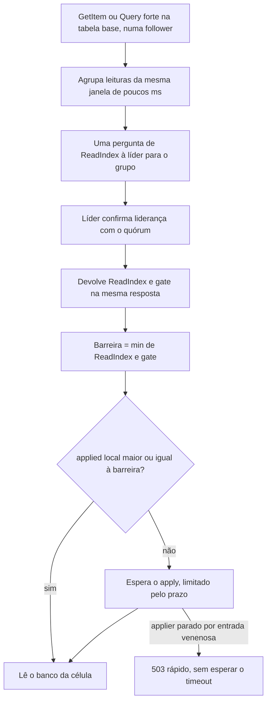

# R16 — Leitura forte em células follower (ReadIndex e gate)

**Status:** 🟡 A rever · resolvido em parte pelo [ADR-049](../../03_adr/ADR-049-barreira-da-leitura-forte-e-o-gate.md) (barreira `min(ReadIndex, gate)`); falta medir a proporção de leituras fortes e definir o SLO de leitura · **ADRs:** [ADR-049](../../03_adr/ADR-049-barreira-da-leitura-forte-e-o-gate.md), [ADR-050](../../03_adr/ADR-050-gsi-nao-tem-leitura-forte.md), [ADR-053](../../03_adr/ADR-053-eventual-sem-apply-paralelo-na-v1.md), [ADR-023](../../03_adr/ADR-023-modos-de-escrita-e-leitura.md), [ADR-025](../../03_adr/ADR-025-escopo-da-api-v1-e-sdks.md) · **Relacionados:** [C05](../atualizados/C05-leitura-strong-e-eventual.md), [C06](../atualizados/C06-follower-encaminha.md), [X01](../complexos/X01-gate-e-troca-de-lider.md)

## Cenário

O padrão de leitura é **forte** (`READ_MODE_DEFAULT`, e `ConsistentRead=true` sempre é forte), mas só na **tabela base**: em GSI a leitura é sempre eventual e `ConsistentRead=true` é recusado ([ADR-050](../../03_adr/ADR-050-gsi-nao-tem-leitura-forte.md)). Numa célula follower, uma leitura forte precisa (1) perguntar à líder o `ReadIndex` (confirmando que ela ainda é líder) e receber **na mesma resposta o gate**, (2) esperar o apply local alcançar `min(ReadIndex, gate)` e (3) só então ler o banco da própria célula. Todas as leituras do shard passam pela líder para (1), e o custo soma ~1 RTT ao caminho da leitura.

**O que o ADR-049 resolveu.** Antes, a leitura esperava `applied >= ReadIndex`, e no modo Strong o apply só ocorre depois do gate: **uma Azure lenta atrasava as leituras fortes** mesmo sem escrita pendente, acoplando a leitura à saúde do link (faixa cinzenta, [C25](../atualizados/C25-link-lento-faixa-cinzenta.md)). Como um cliente só viu escritas já ACKadas e toda escrita ACKada está abaixo do gate, a barreira correta é `min(ReadIndex, gate)`: desacopla a leitura da Azure e mantém a leitura do que o próprio cliente escreveu.

## Diagrama: Caminho da leitura forte

## Fluxo proposto

1. **Agrupar (batch) pedidos de ReadIndex:** um round-trip serve a muitas leituras. O custo na líder passa a ser por lote, não por leitura.
2. **Gate na mesma resposta:** a follower não guarda um gate antigo; um gate velho enfraqueceria a garantia. A líder recém-eleita só atende leitura forte depois de reconstruir o gate ([ADR-029](../../03_adr/ADR-029-gate-monotonico-na-troca-de-lider.md), [ADR-046](../../03_adr/ADR-046-gate-so-conta-progresso-validado-pelo-raft.md)).
3. **Leitura forte em célula Azure:** soma o RTT do link e depende do apply do Cosmos ([R03](R03-backlog-de-apply-no-cosmos.md)). Se o atraso passar de um limite, encaminhar a leitura forte a uma célula AWS (limite de 3 s) em vez de esperar.
4. **Applier parado:** com o applier parado por entrada venenosa ([C26](../atualizados/C26-entrada-venenosa.md)), a leitura forte do shard falha rápido com `503`, em vez de todas as leituras esperarem até o timeout.
5. **Leituras por lease** ficam desligadas por padrão (dependência de relógio, H9); só se o ReadIndex em lote não for suficiente.
6. **Métricas:** `read_index_wait`, `apply_wait` e fila na líder, por célula, além de `last_committed`, `last_azure_durable`, `last_acked` e `last_applied`.

## Falhas e tratativas

- **Líder como gargalo.** Se a maioria das leituras for forte e houver muitas células, a líder confirma liderança com muita frequência. O batch limita isso, mas o spike S1/S5 deve medir com a proporção real de leitura e escrita.
- **Requisito sobre o apply.** A barreira só é correta se `applied` nunca passar do gate; é o que o ADR-053 garante ao tirar o apply paralelo do modo Eventual. O modelo TLA+ cobre isso (P17 em [X01](../complexos/X01-gate-e-troca-de-lider.md)).

## Pontos em aberto

- Proporção real de leituras fortes por escrita e SLO de latência de leitura (hoje só existe a meta de escrita); entra no SLO ponta a ponta ([R18](R18-rto-nao-quantificado.md)).
