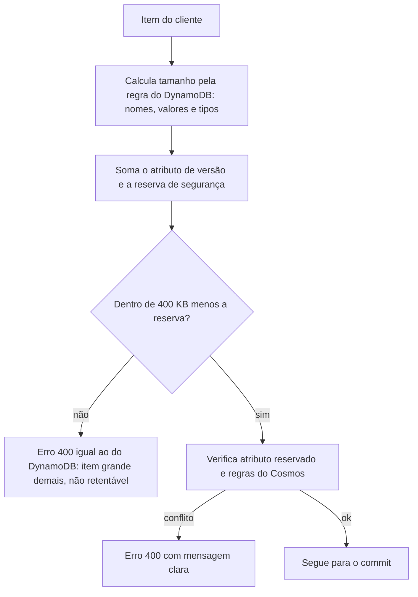
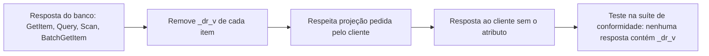

# R17 — Atributo de versão: limite de 400 KB e ausência nas respostas

**Status:** 🟡 A rever · regra "`_dr_v` nunca aparece nas respostas" decidida em 13/10 ([ADR-051](../../03_adr/ADR-051-compatibilidade-dynamodb-inventario-conformidade-e-idempotencia.md)); falta nome definitivo (H-DR3), reserva de tamanho e levantamento de itens grandes · **ADRs:** [ADR-015](../../03_adr/ADR-015-wal-post-image-e-versao.md), [ADR-051](../../03_adr/ADR-051-compatibilidade-dynamodb-inventario-conformidade-e-idempotencia.md), [ADR-025](../../03_adr/ADR-025-escopo-da-api-v1-e-sdks.md), [ADR-032](../../03_adr/ADR-032-parse-json-completo-e-rust.md) · **Relacionados:** [C03](../atualizados/C03-escrita-strong.md), [C22](../atualizados/C22-cliente-com-sdk-nao-suportado.md), [C26](../atualizados/C26-entrada-venenosa.md)

## Cenário

A versão (`_dr_v`, nome a definir, H-DR3) precisa ser **gravada dentro do item**. Isso tem quatro consequências: o parse e a reescrita do item no caminho da requisição (H-DR6), o atributo conta nos **400 KB** do item do DynamoDB, o nome pode colidir com um atributo do cliente e o atributo **não pode vazar para o cliente**: a aplicação nunca deve ver `_dr_v` nas respostas.

**Risco de tamanho:** um item do cliente com 399,99 KB passa na API e, ao receber `_dr_v` (nome + número, algumas dezenas de bytes), **passa de 400 KB no apply**. A entrada já está commitada e vira entrada venenosa ([C26](../atualizados/C26-entrada-venenosa.md)).

**Risco de transparência:** o atributo está no banco, então um `GetItem`, uma `Query` ou um `Scan` sem tratamento o devolveriam, e uma projeção sem o atributo poderia mudar o tamanho da resposta. A camada remove `_dr_v` de todas as respostas.

## Diagrama: Validação de tamanho antes do commit

## Diagrama: O atributo não sai nas respostas

## Fluxo proposto

1. O tamanho é calculado **pela regra do DynamoDB** (nome do atributo + valor, com os tamanhos por tipo), somando `_dr_v` e uma reserva fixa (sugestão: 1 KB).
2. O erro devolvido é o mesmo que o SDK entende como **não retentável**, para que ele não repita a escrita.
3. Atributo `_dr_v` é **reservado e documentado**: se o cliente já tem atributo com esse nome, a escrita é recusada na API.
4. Regras do Cosmos entram na mesma validação: nomes de propriedade, profundidade de aninhamento, precisão numérica (por isso valores monetários como String) e tamanho do documento.
5. **`_dr_v` nunca aparece nas respostas** (`GetItem`, `Query`, `Scan`, `BatchGetItem` e projeções), com teste na suíte de conformidade, que compara DynamoDB real, camada e Cosmos pelo Cloud-Adapter (PEND-16, [ADR-051](../../03_adr/ADR-051-compatibilidade-dynamodb-inventario-conformidade-e-idempotencia.md)).

## Falhas e tratativas

- **Item que já existe no limite.** Um item gravado direto no DynamoDB (antes da camada) já com 399,9 KB não consegue ser reescrito por esta camada. Levantar esse caso nas tabelas dos clientes antes da migração, junto com o inventário de chamadas (PEND-15).
- **Entrada de até 4 MiB.** O limite de entrada de 4 MiB é do log, não do item; o item continua limitado a 400 KB.
- **Tamanho da resposta e da página.** Como a resposta de `Query` e `Scan` é limitada em 1 MB no DynamoDB, remover o atributo depois da leitura não pode mudar a paginação em relação à do DynamoDB; é item da suíte de conformidade.

## Pontos em aberto

- Nome definitivo do atributo (H-DR3), tamanho da reserva e levantamento de itens grandes existentes nas tabelas dos clientes.
