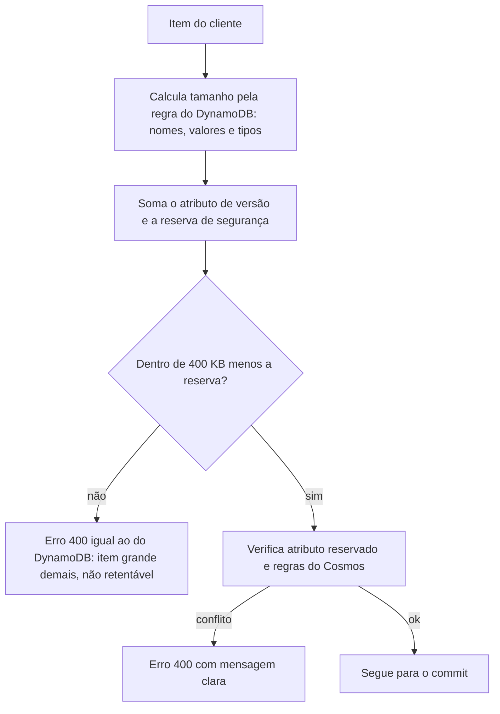

# R17 — Atributo de versão e o limite de 400 KB do item

**Status:** ⚠️ A rever · proposta ainda não aprovada · **ADRs:** [ADR-015](../../03_adr/ADR-015-wal-post-image-e-versao.md), [ADR-025](../../03_adr/ADR-025-escopo-da-api-v1-e-sdks.md), [ADR-032](../../03_adr/ADR-032-parse-json-completo-e-rust.md) · **Relacionados:** [C03](../atualizados/C03-escrita-strong.md), [C22](../atualizados/C22-cliente-com-sdk-nao-suportado.md)

## Cenário

A versão (`_dr_v`, nome a definir, H-DR3) precisa ser **gravada dentro do item**. Isso tem três consequências: o parse e a reescrita do item no caminho da requisição (H-DR6), o atributo conta nos **400 KB** do item do DynamoDB, e o nome pode colidir com um atributo do cliente.

**Risco principal:** um item do cliente com 399,99 KB passa na API e, ao receber `_dr_v` (nome + número, algumas dezenas de bytes), **passa de 400 KB no apply**. A entrada já está commitada e vira entrada venenosa ([C26](../atualizados/C26-entrada-venenosa.md)).

## Diagrama: Validação de tamanho antes do commit

## Fluxo proposto

1. O tamanho é calculado **pela regra do DynamoDB** (nome do atributo + valor, com os tamanhos por tipo), somando `_dr_v` e uma reserva fixa (sugestão: 1 KB).
2. O erro devolvido é o mesmo que o SDK entende como **não retentável**, para que ele não repita a escrita.
3. Atributo `_dr_v` é **reservado e documentado**: se o cliente já tem atributo com esse nome, a escrita é recusada na API.
4. Regras do Cosmos entram na mesma validação: nomes de propriedade, profundidade de aninhamento, precisão numérica (por isso valores monetários como String) e tamanho do documento.

## Falhas e tratativas

- **Item que já existe no limite.** Um item gravado direto no DynamoDB (antes da camada) já com 399,9 KB não consegue ser reescrito por esta camada. Levantar esse caso nas tabelas dos clientes antes da migração.
- **Entrada de até 4 MiB.** O limite de entrada de 4 MiB é do log, não do item; o item continua limitado a 400 KB.

## Pontos em aberto

- Nome definitivo do atributo (H-DR3), tamanho da reserva e levantamento de itens grandes existentes nas tabelas dos clientes.
