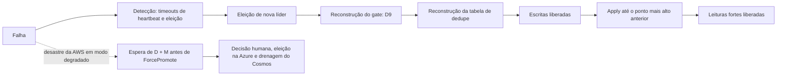

# R18 — RTO (Delta-T) ainda sem número

**Status:** ❓ A rever · método decidido em 13/10 (distribuição medida em exercícios de falha, SLO ponta a ponta); falta medir e definir a meta por tipo de falha · **ADRs:** [ADR-020](../../03_adr/ADR-020-raft-etcd-io-camada-multigrupo.md), [ADR-029](../../03_adr/ADR-029-gate-monotonico-na-troca-de-lider.md), [ADR-034](../../03_adr/ADR-034-fsync-fatal-e-identidade-nova.md), [ADR-044](../../03_adr/ADR-044-lease-do-modo-degradado-e-promocao-da-azure.md) · **Relacionados:** [C18](../atualizados/C18-partida-e-recuperacao-do-no.md), [C08](../atualizados/C08-queda-de-celula-lider-ou-az-aws.md), [X03](../complexos/X03-desastre-e-promocao-da-azure.md), [X04](../complexos/X04-partida-recuperacao-e-dois-logs.md)

## Cenário

O RTO do projeto é `Delta-T`, a ser definido com testes. Hoje não há medição de nenhum dos componentes. Sem isso, o tempo de recuperação em cada falha é uma incógnita, e o RTO do desastre ainda depende de decisão humana ([R10](R10-operador-lento-no-desastre.md)) e, em instalações `accept`, de uma espera de pelo menos D + M quando a AWS morre em modo degradado ([ADR-044](../../03_adr/ADR-044-lease-do-modo-degradado-e-promocao-da-azure.md)).

**O contrato não é uma soma de percentis.** O que o cliente vive é a operação completa, não a soma dos piores casos de cada etapa. Por isso o contrato é um **SLO ponta a ponta** (latência, taxa de erro e recuperação) medido sobre a operação completa, e o RTO de cada tipo de falha é uma **distribuição medida em exercícios de falha** (mediana, P95 e pior caso observado), não um número calculado somando P99.

## Diagrama: De onde vem o RTO

## Fluxo proposto

1. **Exercícios de falha** (game days e testes automatizados) nos cenários C08 (líder cai), C18 (reinício), C19 (processo cai), C14 (promoção) e C32 (partição e lease): cada exercício mede a operação completa, do instante da falha ao instante em que o cliente volta a ser atendido.
2. **Registrar a distribuição** (mediana, P95, pior caso e número de execuções) por tipo de falha. Os tempos de cada etapa servem para diagnosticar onde está o tempo, **não** para somar P99 e anunciar como RTO.
3. **SLO ponta a ponta** definido sobre a operação completa: latência de escrita e de leitura, taxa de erro e tempo de recuperação, com o negócio. Substitui qualquer contrato feito por soma de percentis de etapas.
4. Definir o `Delta-T` por tipo de falha (nó, AZ, nuvem, desastre com a AWS em modo normal e em modo degradado), em vez de um número único. No desastre em modo degradado o piso é D + M, que vem do aceite do negócio.

## Falhas e tratativas

- **Etapas sem teste hoje.** Tempo de eleição com `ElectionTick` real, replay do log do Raft, reconstrução do gate (D9), reconstrução da tabela de dedupe ([R22](R22-memoria-da-janela-de-dedupe.md)), tempo para o `appliedIndex` alcançar o ponto anterior (guardado em arquivo local) e drenagem de backlog do Cosmos na promoção ([R03](R03-backlog-de-apply-no-cosmos.md)).
- **EBS preso à AZ.** Se a AZ inteira cai, o volume do log da célula fica indisponível; a recuperação vem das outras células, não do volume.
- **Poucas amostras.** Uma distribuição com poucos exercícios engana; registrar o número de execuções e repetir depois de cada mudança relevante.

## Pontos em aberto

- Plano de medição nos spikes S2 a S6 e meta de `Delta-T` por tipo de falha (com o negócio).
