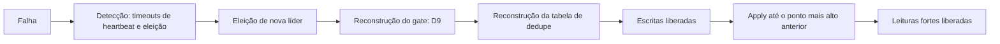

# R18 — RTO (Delta-T) ainda sem número

**Status:** ❓ A rever · sem resolução · **ADRs:** [ADR-020](../../03_adr/ADR-020-raft-etcd-io-camada-multigrupo.md), [ADR-029](../../03_adr/ADR-029-gate-monotonico-na-troca-de-lider.md), [ADR-034](../../03_adr/ADR-034-fsync-fatal-e-identidade-nova.md) · **Relacionados:** [C18](../atualizados/C18-partida-e-recuperacao-do-no.md), [C08](../atualizados/C08-queda-de-celula-lider-ou-az-aws.md), [X04](../complexos/X04-partida-recuperacao-e-dois-logs.md)

## Cenário

O RTO do projeto é `Delta-T`, a ser definido com testes. Hoje não há medição de nenhum dos componentes. Sem isso, o tempo de recuperação em cada falha é uma incógnita, e o RTO do desastre ainda depende de decisão humana ([R10](R10-operador-lento-no-desastre.md)).

## Diagrama: De onde vem o RTO

## Fluxo proposto

1. Medir cada etapa nos cenários C08 (líder cai), C18 (reinício), C19 (processo cai) e C14 (promoção).
2. Registrar P50, P99 e máximo; o RTO do cenário é a soma dos P99 de etapas sequenciais, não o P99 da soma.
3. Definir o `Delta-T` por tipo de falha (nó, AZ, nuvem), em vez de um número único.

## Falhas e tratativas

- **Etapas sem teste hoje.** Tempo de eleição com `ElectionTick` real, replay do log do Raft, reconstrução do gate (D9), reconstrução da tabela de dedupe ([R22](R22-memoria-da-janela-de-dedupe.md)), tempo para o `appliedIndex` alcançar o ponto anterior (guardado em arquivo local) e drenagem de backlog do Cosmos na promoção ([R03](R03-backlog-de-apply-no-cosmos.md)).
- **EBS preso à AZ.** Se a AZ inteira cai, o volume do log da célula fica indisponível; a recuperação vem das outras células, não do volume.

## Pontos em aberto

- Plano de medição nos spikes S2 a S6 e meta de `Delta-T` por tipo de falha (com o negócio).
