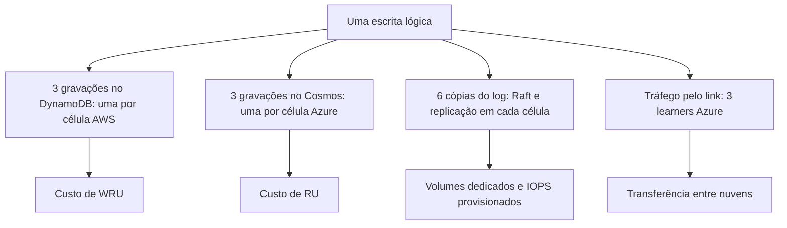

# R20 — Custo: cada escrita lógica vira seis gravações

**Status:** ⚠️ A rever · proposta ainda não aprovada · **ADRs:** [ADR-022](../../03_adr/ADR-022-banco-por-celula-nome-logico.md), [ADR-017](../../03_adr/ADR-017-azure-learners-e-gate.md) · **Relacionados:** [C01](../atualizados/C01-visao-geral.md)

## Cenário

Cada escrita lógica é aplicada em **seis bancos**: 3 DynamoDB (um por célula AWS) e 3 Cosmos (um por célula Azure). A decisão de um banco por célula ([ADR-022](../../03_adr/ADR-022-banco-por-celula-nome-logico.md)) trouxe independência entre células, mas multiplica o custo de gravação por seis, além de volumes de disco, tráfego pelo link e seis clusters.

## Diagrama: Onde o custo se multiplica

## Fluxo proposto

1. Estimativa do custo mensal com os números reais: tamanho médio do item, TPS de escrita por tabela e preços vigentes de DynamoDB sob demanda e Cosmos em RU.
2. Medir as RU por escrita no Cosmos com o Cloud-Adapter (escrita condicional incluída).
3. Se o custo for alto, comparar alternativas **sem trocar o requisito de RPO 0**: DynamoDB com menos cópias por cloud, ou apenas o líder escrevendo no banco enquanto as demais ficam só com o log.

## Falhas e tratativas

- **Escrita condicional.** Condições de versão podem custar o mesmo que uma escrita simples, mas confirmar no teste. `TransactWriteItems` custaria o dobro ([C23](../atualizados/C23-batchwriteitem-lote-uma-entrada.md)).
- **Multiplicado por cliente (13/10).** Cada cliente é uma instalação completa e isolada ([ADR-043](../../03_adr/ADR-043-uma-instalacao-por-cliente-identidade-por-configuracao.md)): os seis bancos, os seis clusters e os volumes se repetem por time. A estimativa precisa de um custo por cliente e de um custo fixo mínimo, não só da fórmula por escrita.
- **Apply de leitura.** Leituras fortes em célula follower lêem o banco local, então a carga de leitura se espalha, mas cada célula tem a sua cobrança.

## Ordem de grandeza (sem preços)

Premissa a confirmar: ~3.000 escritas lógicas por segundo contínuas.

| Medida | Cálculo | Resultado |
|---|---|---|
| Escritas lógicas por mês | 3.000 × 86.400 × 30 | ≈ 7,8 bilhões |
| Gravações nos DynamoDB por mês | 7,8 bi × 3 células | ≈ 23,3 bilhões de itens |
| Gravações nos Cosmos por mês | 7,8 bi × 3 células | ≈ 23,3 bilhões de itens |
| Unidades de gravação do DynamoDB | gravações × ⌈tamanho do item em KB⌉ | por exemplo, itens de 2 KB: ≈ 46,6 bilhões de WRU por mês |
| Dados replicados pelo link | 3.000 × tamanho × 3 learners | com 2 KB, ≈ 18 MB/s |

Preços e RU por escrita ficam para a estimativa de custo; os números acima só dimensionam o volume.

## Pontos em aberto

- Quem estima e valida o custo (FinOps) e o teto aceitável por mês.
