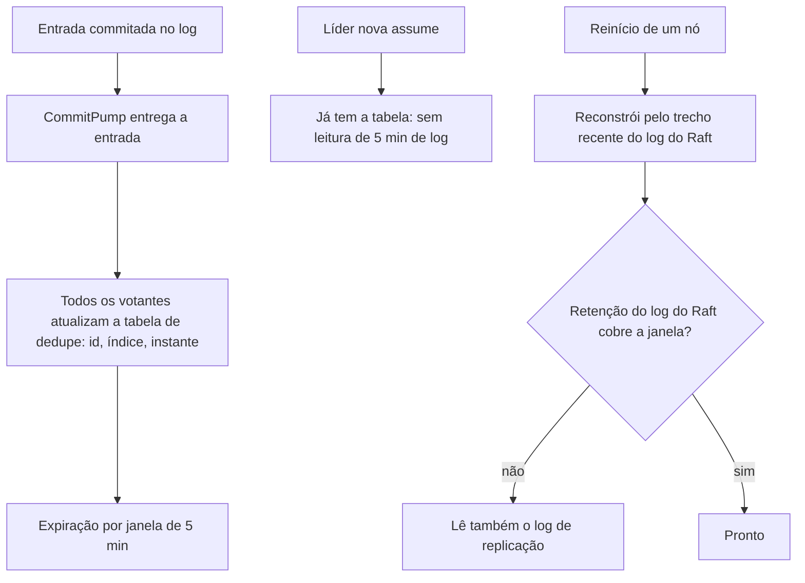

# R22 — Memória da janela de dedupe

**Status:** 🆕 A rever · achado novo desta revisão · **ADRs:** [ADR-026](../../03_adr/ADR-026-dedupe-de-retry-id-estavel.md), [ADR-028](../../03_adr/ADR-028-timeouts-em-cascata.md) · **Relacionados:** [C07](../atualizados/C07-timeout-depois-do-commit.md), [C19](../atualizados/C19-falha-do-datareplication.md), [X05](../complexos/X05-timeouts-e-idempotencia.md)

## Cenário

A janela de dedupe de 5 minutos precisa lembrar, na líder, o identificador estável de cada requisição recente. A 3.000 TPS são **~900 mil identificadores** na janela (3.000 × 300 s). Com ~64 bytes por registro (id, índice, instante, estado), são **~58 MiB por shard**, que não estavam no orçamento de memória do pod.

**Efeito escondido:** a tabela de dedupe tem de existir **na líder nova** quando ela assume. Se só a líder a mantém, a nova líder reconstrói lendo 5 minutos de log (~1,8 GB a 2 KB por entrada) durante a eleição, inflando o RTO.

## Diagrama: Tabela mantida por todos os votantes

## Fluxo proposto

1. A tabela é uma **projeção do log**: todo votante a atualiza ao aplicar o commit, então qualquer um pode virar líder sem reconstruir.
2. A **retenção do log do Raft** precisa cobrir a janela de dedupe mais uma margem; senão a reconstrução no reinício lê o log de replicação.
3. Incluir ~58 MiB (e a variação com o tamanho do id) no orçamento de memória e em `GOMEMLIMIT`; estrutura compacta (tabela hash com id de 16 a 36 bytes) e expiração em lotes.
4. Janela configurável (`DEDUPE_WINDOW`), com métrica de ocupação e de acertos.

## Falhas e tratativas

- **ABA fora da janela.** Retry da **aplicação** acima do SDK, depois de mais de 5 min, escapa do dedupe. Para um `PutItem`, isso pode sobrescrever uma escrita mais nova da mesma chave (A, depois B por outro cliente, depois a repetição de A). Confirmar com os times se alguma aplicação retenta por cima do SDK.
- **Id estável.** O dedupe depende de um identificador estável por SDK (por exemplo `amz-sdk-invocation-id`). **Verificar em cada SDK** (Java 2.x, Go v2, .NET v4) que o valor é o mesmo entre as tentativas; hash do conteúdo é só o último recurso e causa falso positivo para escritas idênticas legítimas ([ADR-026](../../03_adr/ADR-026-dedupe-de-retry-id-estavel.md)).

## Pontos em aberto

- Confirmar o cabeçalho de identificador estável em cada SDK e se alguma aplicação retenta por cima do SDK (PEND-02/D13).
- Retenção do log do Raft e tamanho da janela depois do spike.
