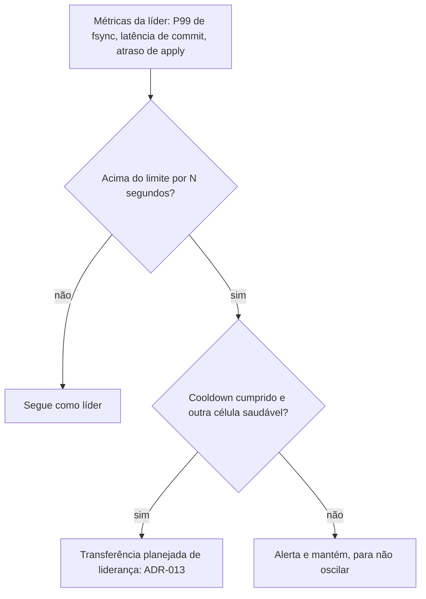

# R23 — Hipóteses gerais em aberto

**Status:** ❓ A rever · sem resolução · **ADRs:** [ADR-030](../../03_adr/ADR-030-verificacao-formal-tla.md), [ADR-033](../../03_adr/ADR-033-promocao-da-azure-humana.md), [ADR-014](../../03_adr/ADR-014-modo-degradado-opcao-b.md), [ADR-032](../../03_adr/ADR-032-parse-json-completo-e-rust.md), [ADR-044](../../03_adr/ADR-044-lease-do-modo-degradado-e-promocao-da-azure.md), [ADR-045](../../03_adr/ADR-045-politica-de-degradacao-por-instalacao.md), [ADR-046](../../03_adr/ADR-046-gate-so-conta-progresso-validado-pelo-raft.md), [ADR-049](../../03_adr/ADR-049-barreira-da-leitura-forte-e-o-gate.md) · **Relacionados:** [C12](../atualizados/C12-modo-degradado.md), [C32](../atualizados/C32-particao-e-lease-do-modo-degradado.md), [X02](../complexos/X02-modo-degradado.md), [X03](../complexos/X03-desastre-e-promocao-da-azure.md)

## Cenário

Este arquivo reúne as hipóteses de falha que **não viraram um cenário próprio**: algumas já têm tratamento parcial, outras seguem sem solução. As que têm cenário dedicado aparecem na tabela com o link.

## Índice das hipóteses

| Id | Hipótese | Tratada em | Situação |
|---|---|---|---|
| H1 / PEND-01 | Split-brain na promoção com a AWS viva | [R12](R12-promocao-com-aws-viva.md) | Desenho decidido (lease, ADR-044); fecha com D e M aprovados e prova no TLA+. Promoção automática: não reabrir |
| H2 / PEND-02 | RPO > 0 no modo degradado: aprovar o valor de D (teto do lease) | abaixo | **Bloqueante** (falta aprovar D e M) |
| H3 / PEND-03 | Reconciliação de órfãs | [R13](R13-escritas-orfas-reconciliacao.md) | Parcial: janela limitada por D; falta dono e política |
| H4 / PEND-11 | Líder lenta, mas viva | abaixo | Proposta |
| H5 | Duas AZs da AWS caem | [R06](R06-duas-azs-aws-caem.md) | Desenho decidido (lease); falta D e prova no TLA+ |
| H6 | Tempo de decisão humana | [R10](R10-operador-lento-no-desastre.md) | Sem resolução |
| H7 | Corrupção lógica ou bug replicado | abaixo | Proposta |
| H8 | Bug no consenso customizado | abaixo | Mitigado por ADR-030 e ADR-046 (TLA+ ampliado) |
| H9 | Dependência de relógio nas leituras fortes | abaixo | Mitigado: ReadIndex com barreira `min(ReadIndex, gate)`. O lease do modo degradado é outro mecanismo e depende de relógio limitado (ADR-044) |
| H10 | Plano de controle e identidade dos provedores | abaixo | Aberta |
| H11 | Shard maior que a capacidade de um log | abaixo | Aberta |
| H-DR1 | Reconstrução automática de réplica | abaixo | Manual assistida na v1, com protocolo de tabela sombra (ADR-047) |
| H-DR2 | Desvio automático de entrada venenosa | [C26](../atualizados/C26-entrada-venenosa.md) | Decidido: humano (ADR-038) |
| H-DR3 | Nome do atributo de versão | [R17](R17-atributo-de-versao-e-limite-400kb.md) | Aberta |
| H-DR4 | Chave quente que satura um shard | abaixo | Medir |
| H-DR5 | Learner Azure lento, mas vivo | [C25](../atualizados/C25-link-lento-faixa-cinzenta.md) | Só alerta (ADR-037) |
| H-DR6 | Parse completo do JSON no caminho quente | abaixo | **Aceita** pelo Bruno |
| H-DR13 | Prorrogação do lease x promoção da Azure | abaixo | Aberta: regra a fechar no TLA+ |
| H-DR14 | Partição assimétrica entre AWS e Azure | abaixo | Aberta: modelar no TLA+ |
| H-DR15 | Semântica do Cosmos depois do failover | abaixo | Aberta: entra na suíte de conformidade |

## H2 / PEND-02. RPO > 0 sem teto no modo degradado (bloqueante)

**Explicação.** A perda possível cresce com a duração da degradação. O header `x-dr-mode: degraded` informa o cliente, mas não limita a perda. O Bruno decidiu pela opção B ([ADR-014](../../03_adr/ADR-014-modo-degradado-opcao-b.md)). Desde 13/10 o teto existe no desenho: a entrada `DEGRADE` carrega um lease de duração **D** (`DEGRADED_LEASE`), e ao fim dele a AWS para de aceitar escrita ([ADR-044](../../03_adr/ADR-044-lease-do-modo-degradado-e-promocao-da-azure.md)). D é o teto de duração do RPO > 0. O que continua bloqueante é o **aceite formal do negócio**: aprovar o valor de D (e de M, a margem de promoção) e aceitar o custo de que, se a AWS morrer em modo degradado, o RTO é pelo menos D + M. A política por instalação (`DEGRADED_POLICY`, [ADR-045](../../03_adr/ADR-045-politica-de-degradacao-por-instalacao.md)) deixa o cliente escolher `reject` (RPO 0 sempre, menos disponibilidade).

**Caminhos:**
- Aprovar **D, M e a política por cliente** (`accept` ou `reject`); passado D, uma pessoa decide entre prorrogar (`RENEW`) ou parar. Valores ainda **a definir**.
- Segundo circuito privado por outra operadora, para degradar menos ([C25](../atualizados/C25-link-lento-faixa-cinzenta.md)).
- Exportação periódica do log degradado para um armazenamento que a Azure consiga ler depois (reduz a perda, não elimina; [R13](R13-escritas-orfas-reconciliacao.md)).

## H4 / PEND-11. Líder lenta, mas viva

**Explicação.** Uma líder com disco ou rede degradados continua mandando heartbeat e não perde a eleição, mas deixa todas as escritas lentas.

**Caminho:** critério de saúde além do heartbeat, com histerese e cooldown, disparando a transferência planejada ([ADR-013](../../03_adr/ADR-013-transferencia-planejada-de-lideranca.md)). Falha de fsync continua sendo fatal ([ADR-034](../../03_adr/ADR-034-fsync-fatal-e-identidade-nova.md)); o watchdog cobre a lentidão sem erro.

## H7. Corrupção lógica ou bug replicado

**Explicação.** RPO 0 replica tudo, inclusive erros. Um deploy com bug que grava dado errado é replicado na hora para as duas clouds.

**Caminhos:** backup contínuo dos dois bancos (PITR no DynamoDB, backup contínuo no Cosmos); retenção do log suficiente para reconstruir o estado até um índice anterior ao erro; validação de esquema e de capacidades antes do commit ([C26](../atualizados/C26-entrada-venenosa.md)).

## H8. Bug no consenso customizado

**Explicação.** A regra "eleição só na AWS + gate com maioria Azure + degradação" não é Raft padrão. Um erro sutil pode perder dado ou causar split-brain sem falha de infraestrutura.

**Tratamento:** modelo TLA+ **antes** do código do gate, ampliado com lease, promoção entre nuvens, troca de membros, dedupe, resultado desconhecido, I-DEL e a barreira da leitura forte ([ADR-030](../../03_adr/ADR-030-verificacao-formal-tla.md), [ADR-046](../../03_adr/ADR-046-gate-so-conta-progresso-validado-pelo-raft.md), [X01](../complexos/X01-gate-e-troca-de-lider.md)) e testes tipo Jepsen (partições, pausas, relógios defasados). O Raft em si é o `etcd-io/raft`, mantido fora do código nosso.

## H9. Dependência de relógio nas leituras fortes

**Explicação.** Leituras por lease confiam que o relógio dos nós não deriva além de um limite.

**Tratamento:** a leitura forte usa **ReadIndex** com a barreira `min(ReadIndex, gate)`, não lease ([R16](R16-leitura-forte-em-celulas-follower.md), [ADR-049](../../03_adr/ADR-049-barreira-da-leitura-forte-e-o-gate.md)). Se um dia lease for usado para leitura, monitorar o desvio de relógio e desligar acima de um limite. O **lease do modo degradado** é outra coisa e depende de relógio limitado: a deriva máxima faz parte de M ([ADR-044](../../03_adr/ADR-044-lease-do-modo-degradado-e-promocao-da-azure.md)).

## H10. Plano de controle e identidade dos provedores

**Explicação.** Incidentes globais costumam ser de identidade ou DNS, não de dados. Se o acesso ao Cosmos ou ao DynamoDB depender de emitir um token no momento da escrita, o caminho de dados para com os bancos de pé.

**Caminhos:** credenciais com rotação controlada e tokens de validade longa em cache; testar a camada com o serviço de identidade do provedor indisponível ([R11](R11-api-de-promocao-depende-da-aws.md), [C31](../atualizados/C31-implantacao-por-cliente-e-identidade.md)).

## H11. Crescimento de um shard além da capacidade de um log

**Explicação.** Com ordenação por shard, cada shard tem uma líder e um log. Se um segmento crescer muito além de 3.000 TPS, não há procedimento de divisão de shard.

**Caminhos:** desenhar o split de shard (novo grupo de consenso, cópia, troca de roteamento) ou evoluir para ordenação por chave de partição com apply paralelo por chave.

## H-DR1. Reconstrução automática de réplica

**Explicação.** Quando uma réplica perde o disco ou fica fora da janela de retenção, a v1 usa `drctl rebuild`, **manual assistido** ([C21](../atualizados/C21-disco-fsync-e-reconstrucao.md)). O protocolo de reconstrução em tabela sombra ([ADR-047](../../03_adr/ADR-047-delete-real-invariante-e-reconstrucao-em-tabela-sombra.md), [C33](../atualizados/C33-reconstrucao-em-tabela-sombra.md)) define os passos; a automação completa (copiar de outra célula, validar, entrar como learner) fica em aberto e é a exceção à meta "recupera sem humano" (junto com PEND-01).

## H-DR4. Chave quente

**Explicação.** Muitas escritas à mesma chave serializam na fila por chave do applier e podem estourar throttling por partição no DynamoDB.

**Caminhos:** backpressure por chave e por cliente com os erros do DynamoDB que o SDK já entende ([ADR-025](../../03_adr/ADR-025-escopo-da-api-v1-e-sdks.md)); medir no teste de carga.

## H-DR6. Parse completo do JSON (aceita)

**Decisão do Bruno (12/10):** o custo de CPU e alocação do parse completo é **conhecido e aceito** ([ADR-032](../../03_adr/ADR-032-parse-json-completo-e-rust.md)). Medir no spike S2; revisitar se heartbeat ou P99 forem afetados. Ideia adiada: guardar o corpo em bytes no log e varrer só o nome da tabela.

## H-DR13. Prorrogação do lease x promoção da Azure

**Explicação.** Prorrogar o lease (`RENEW`) depois de a Azure já poder ser promovida (D + M passados) reabre o risco de duas pontas aceitarem escrita. A prorrogação é humana e replicada no Raft da AWS, mas a Azure não vê esse Raft.

**Caminho:** regra no modelo TLA+, por exemplo marcar a Azure como `promotion_blocked` antes de prorrogar, ou recusar a prorrogação depois de um limite. A regra precisa ser provada (P12 em [X01](../complexos/X01-gate-e-troca-de-lider.md)) antes de a PEND-01 fechar ([ADR-044](../../03_adr/ADR-044-lease-do-modo-degradado-e-promocao-da-azure.md), [X02](../complexos/X02-modo-degradado.md)).

## H-DR14. Partição assimétrica

**Explicação.** Quando um sentido do link funciona e o outro não, o "último contato" visto pela Azure e o gate visto pela AWS divergem: por exemplo, a AWS não recebe as respostas da Azure e degrada, mas a Azure ainda recebe os heartbeats da AWS, ou o contrário. Também é preciso definir o que conta como "contato da AWS" (qualquer votante ou só a líder, [R06](R06-duas-azs-aws-caem.md)).

**Caminho:** modelar partições simétricas e assimétricas no TLA+ ([C32](../atualizados/C32-particao-e-lease-do-modo-degradado.md)) e confirmar que o prazo D + M, medido no relógio da Azure, continua seguro.

## H-DR15. Semântica do Cosmos depois do failover

**Explicação.** Depois do failover a aplicação passa a falar com o Cosmos pelo Cloud-Adapter. Diferenças de tamanho de item, precisão de `Number`, índices consistentes por padrão (o do DynamoDB não é) e TTL podem mudar o comportamento que a aplicação via no DynamoDB ([ADR-050](../../03_adr/ADR-050-gsi-nao-tem-leitura-forte.md), [ADR-051](../../03_adr/ADR-051-compatibilidade-dynamodb-inventario-conformidade-e-idempotencia.md)).

**Caminho:** a suíte de conformidade roda a mesma sequência contra o DynamoDB real, a camada e o Cosmos pelo Cloud-Adapter e compara os resultados (PEND-16); a aplicação não deve depender da consistência do índice em nenhuma das duas nuvens.

## Pontos em aberto

- Decisões que dependem do Bruno: PEND-02 (aceite formal do valor de D e do RPO > 0, **bloqueante**) e a aprovação de D e M para fechar a PEND-01, cujo desenho está decidido (ADR-044) e falta a prova no TLA+. A promoção automática segue com os outros arquitetos e não é reaberta.
