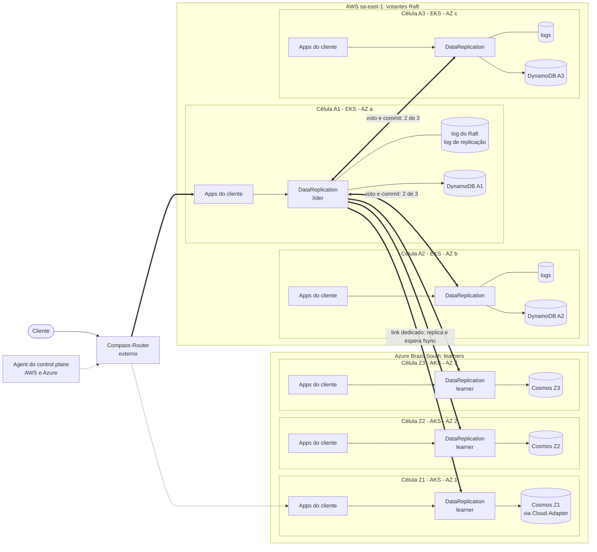

# C01 — Visão geral da arquitetura

**Status:** ✅ Atualizado (modelo v1) · **ADRs:** [ADR-016](../../03_adr/ADR-016-app-unico-por-celula-monolito-modular.md), [ADR-017](../../03_adr/ADR-017-azure-learners-e-gate.md), [ADR-003](../../03_adr/ADR-003-aws-primaria-azure-failover.md), [ADR-054](../../03_adr/ADR-054-banco-por-celula-mantido.md)

## Cenário

Estrutura de um shard em regime normal. Cada célula é um cluster Kubernetes (EKS ou AKS) numa AZ. No namespace do cliente rodam as apps e **um único** `DataReplication`. As 3 células AWS são votantes do Raft; as 3 células Azure são learners. O Compass-Router e o Agent do control plane são externos ao time.

## Diagrama

## Etapas

1. O cliente chama o Compass-Router, que entrega a requisição às apps de uma célula AWS. A rota para a Azure só é usada quando o Agent manda.
2. As apps falam com o `DataReplication` do próprio namespace por uma única porta (API compatível com DynamoDB).
3. Se a célula não for a líder, o `DataReplication` encaminha a escrita à líder por gRPC (1 salto, ver C06).
4. A líder grava no log do Raft com fsync e replica para os 2 votantes AWS e para os 3 learners Azure.
5. O gate libera o ACK quando há commit Raft (2 de 3 AWS) e maioria Azure durável (2 de 3).
6. Cada célula tem o seu banco e o seu applier. A escrita lógica é aplicada nos 6 bancos (3 DynamoDB, 3 Cosmos). O DynamoDB é regional e o Cosmos tem redundância de zona, então os seis bancos **não são seis domínios físicos de falha**: o que eles compram é isolamento lógico (corrupção ou throttling de uma tabela não atinge as outras), e a durabilidade por AZ vem dos três logs Raft ([ADR-054](../../03_adr/ADR-054-banco-por-celula-mantido.md)).

## Falhas e tratativas

- **Compass-Router ou Agent indisponível.** Dependência externa, fora do escopo do time. O router sobrevive à perda total da AWS e o Agent roda nas duas nuvens (confirmado pelo Bruno).
- **Certificados mTLS ou credenciais entre nuvens expiram.** Para a AWS é igual à Azure cair: conforme a `DEGRADED_POLICY`, entra o modo degradado com lease (`accept`) ou a escrita responde `503 PENDING` (`reject`) (C12). Alerta de expiração com antecedência.

## Pontos em aberto

- Link lento ou saturado (falha cinzenta): [C25](C25-link-lento-faixa-cinzenta.md).
