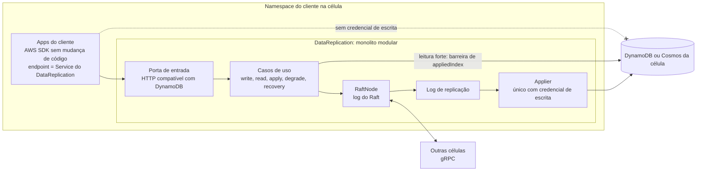

# C02 — Dentro da célula: apps do cliente e DataReplication

**Status:** ✅ Atualizado (modelo v1) · **ADRs:** [ADR-016](../../03_adr/ADR-016-app-unico-por-celula-monolito-modular.md), [ADR-031](../../03_adr/ADR-031-hexagonal-e-bibliotecas.md), [ADR-021](../../03_adr/ADR-021-grpc-entre-celulas.md)

## Cenário

No namespace do cliente, as apps (por exemplo 10 microsserviços) falam com **um único** `DataReplication` por uma porta. Não há sidecar nem HPA: o número de réplicas é o quórum. Uma NetworkPolicy fecha o namespace. As apps **não têm credencial de escrita** nos bancos; só o applier do `DataReplication` escreve.

## Diagrama

## Etapas

1. A app chama o AWS SDK apontando o endpoint para o Service do `DataReplication` no namespace.
2. O `DataReplication` classifica a chamada: escrita, leitura forte ou leitura eventual.
3. Escrita: segue o fluxo de C03 (Strong) ou C04 (Eventual).
4. Leitura: segue o fluxo de C05.
5. O applier é o único com credencial de escrita no banco da célula; a app não consegue contornar a camada.

## Falhas e tratativas

- **Aplicação escreve direto no banco (bypass).** Barrado por IAM: a app não tem credencial de escrita ([C20](C20-bypass-de-escrita-direta.md)).
- **DataReplication cai ou reinicia.** Ver [C19](C19-falha-do-datareplication.md).
- **Cache de líder desatualizado.** A líder antiga recusa ou encaminha, e toda resposta traz a líder e o termo atuais ([ADR-010](../../03_adr/ADR-010-follower-encaminha-para-lider.md)).

## Pontos em aberto

- Autenticação entre apps e `DataReplication` depende da NetworkPolicy do namespace do cliente (uma instalação por cliente): [C31](C31-implantacao-por-cliente-e-identidade.md).
