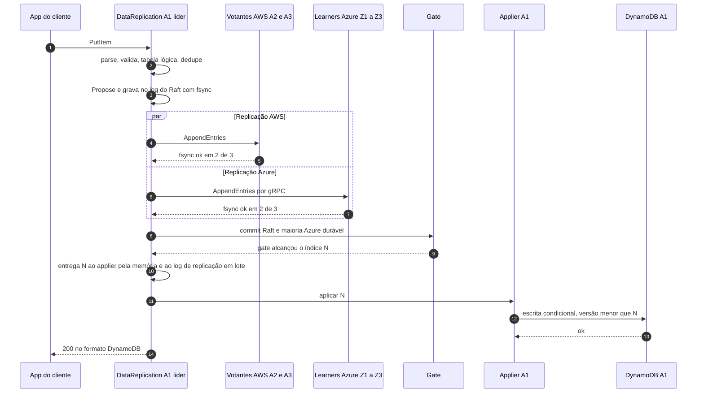

# C03 — Caminho feliz: escrita em modo Strong

**Status:** ✅ Atualizado (modelo v1) · **ADRs:** [ADR-005](../../03_adr/ADR-005-ack-exige-gate.md), [ADR-017](../../03_adr/ADR-017-azure-learners-e-gate.md), [ADR-018](../../03_adr/ADR-018-dois-logs-raft-e-replicacao.md), [ADR-023](../../03_adr/ADR-023-modos-de-escrita-e-leitura.md), [ADR-029](../../03_adr/ADR-029-gate-monotonico-na-troca-de-lider.md) · **Relacionados:** [Orçamento de latência](../../01_arquitetura/06_modos_de_escrita_e_leitura_e_latencia.md)

## Cenário

Regime normal, AWS e Azure se alcançando, `WRITE_MODE=strong`. A app faz um `PutItem`. O `DataReplication` valida, deduplica e propõe a entrada ao Raft. A entrada é gravada com fsync no log do Raft, replicada para 2 de 3 votantes AWS e para 2 de 3 learners Azure. Quando o gate alcança o índice, o applier grava no banco da célula (**em série, depois do gate**) e o ACK sai. RPO = 0. O apply nas outras células é assíncrono.

## Diagrama

## Etapas

1. **Entrada:** o SDK envia o `PutItem` ao `DataReplication` da célula (se não for a líder, ele encaminha, C06).
2. **Preparo:** parse completo do JSON (H-DR6), validação, tradução do nome lógico da tabela e dedupe por identificador estável.
3. **Proposta:** a entrada leva a imagem final do item (post-image) e vira uma entrada do Raft; a versão do item é o índice Raft.
4. **Durabilidade AWS:** fsync no log do Raft da líder e em 2 de 3 votantes.
5. **Durabilidade Azure:** em paralelo, os learners gravam com fsync; 2 de 3 confirmam.
6. **Gate:** `gateIndex = min(commit Raft, maioria Azure durável)` alcança N.
7. **Distribuição:** o `CommitPump` entrega N ao applier pela memória e ao log de replicação em lote (fora do caminho do ACK).
8. **Apply:** no modo Strong, o applier grava no banco da célula só depois do gate, com escrita condicional `v < N`.
9. **ACK:** o `DataReplication` responde ao SDK. As demais células aplicam N de forma assíncrona.

## Falhas e tratativas

- **Apply no banco falha de forma transitória.** Throttling ou erro 5xx depois do commit. A escrita não se perde; a resposta é `503 PENDING` (retentável) e o applier repete com backoff. O retry do SDK é absorvido pelo dedupe e pela versão ([ADR-026](../../03_adr/ADR-026-dedupe-de-retry-id-estavel.md)).
- **Apply falha de forma permanente.** Entrada que o banco recusa sempre trava a ordem: [C26](C26-entrada-venenosa.md).
- **Prazo da requisição estoura.** Ver [C07](C07-timeout-depois-do-commit.md) e [ADR-028](../../03_adr/ADR-028-timeouts-em-cascata.md).

## Pontos em aberto

- O ACK espera o apply só no banco da célula líder (6.9, item 4), então o P99 do DynamoDB entra no caminho do ACK: [C24](C24-orcamento-de-50ms-e-escrita-no-dynamodb.md).
- Latência total depende do RTT AWS↔Azure e do P99 de fsync, ainda não medidos (spike S1).
