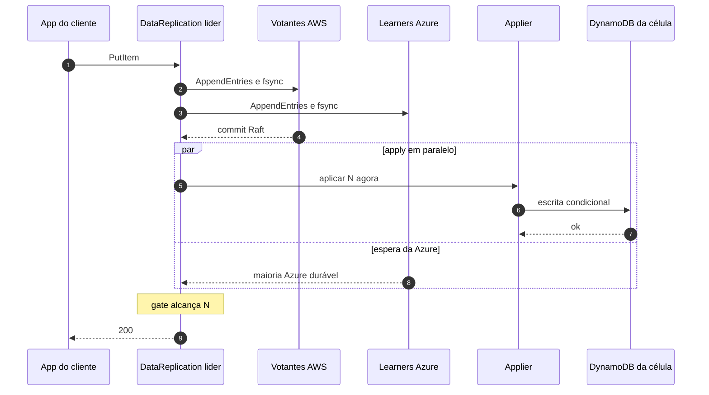

# C04 — Caminho feliz: escrita em modo Eventual

**Status:** ✅ Atualizado (modelo v1) · **ADRs:** [ADR-023](../../03_adr/ADR-023-modos-de-escrita-e-leitura.md), [ADR-009](../../03_adr/ADR-009-eventual-e1.md)

## Cenário

Com `WRITE_MODE=eventual`, o applier da célula líder começa a gravar no banco assim que a AWS confirma o commit, **em paralelo** à espera da Azure. O ACK continua só depois do gate (RPO = 0 do que foi confirmado). O que muda é a janela em que o dado fica visível no banco antes de estar durável na Azure, aceita pelo Bruno (poucos ms).

## Diagrama

## Etapas

1. O fluxo é igual ao de C03 até o commit Raft.
2. Ao confirmar a AWS, o applier grava no banco da célula sem esperar a Azure.
3. O ACK só sai quando o gate alcança N (e o apply termina).
4. O `appliedIndex` só avança até o último índice **contíguo** aplicado, para a barreira da leitura forte seguir correta.
5. A condição de versão descarta a escrita que chegar atrasada para a mesma chave.

## Falhas e tratativas

- **Azure falha depois da gravação no banco.** Não dá para desfazer a gravação. O desfecho segue o modo degradado ([C12](C12-modo-degradado.md)).
- **AWS inteira cai dentro da janela de poucos ms.** O dado visível no banco e ainda não durável na Azure some. Aceito pelo Bruno apenas onde isso for tolerado.
- **Modo diferente entre células do grupo.** O modo é de quem for líder; se divergir, o comportamento muda quando a liderança muda. A conexão entre células troca o modo, e a divergência gera alerta.

## Pontos em aberto

- Dois caminhos no applier (serial e paralelo): implementar o serial primeiro e medir o ganho do paralelo.
