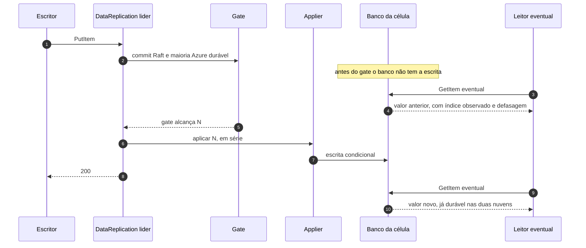

# C04 — Modo Eventual: só de leitura (sem apply paralelo na v1)

**Status:** ✅ Atualizado (modelo v1, revisão crítica de 13/10/2026); o apply paralelo foi retirado da v1 · **ADRs:** [ADR-053](../../03_adr/ADR-053-eventual-sem-apply-paralelo-na-v1.md), [ADR-023](../../03_adr/ADR-023-modos-de-escrita-e-leitura.md), [ADR-009](../../03_adr/ADR-009-eventual-e1.md), [ADR-049](../../03_adr/ADR-049-barreira-da-leitura-forte-e-o-gate.md) · **Relacionados:** [C03](C03-escrita-strong.md), [C05](C05-leitura-strong-e-eventual.md), [C24](C24-orcamento-de-50ms-e-escrita-no-dynamodb.md)

## Cenário

O pacote chegou a prever um modo Eventual de **escrita**, com o applier da célula líder gravando no banco assim que a AWS confirmasse o commit, em paralelo à espera da Azure. Esse modo foi retirado: um leitor poderia ver uma escrita ainda **não durável na Azure** que nunca seria ACKada se a AWS caísse antes, e quem leu agiu sobre um valor que depois "não aconteceu". O ganho era esconder `t_apply` (alguns ms) atrás da Azure, desproporcional ao risco.

Na v1 o **Eventual existe só como modo de leitura** (o E1 do [ADR-009](../../03_adr/ADR-009-eventual-e1.md)). A escrita tem um único caminho: apply serial e depois do gate ([C03](C03-escrita-strong.md)). A variável `WRITE_MODE` saiu da configuração. O que o cliente escolhe é o modo de leitura (`READ_MODE_DEFAULT`, `ConsistentRead`).

## Diagrama

## Etapas

1. A escrita segue o fluxo de C03: o banco só recebe N depois do gate. Por isso **nenhum leitor, forte ou eventual, vê uma escrita que não esteja durável na Azure** (com a política `accept` em modo degradado, a exceção é a do [C12](C12-modo-degradado.md)).
2. A leitura eventual lê o banco local sem falar com a líder e informa `observedIndex` e a defasagem em headers (C05).
3. O `appliedIndex` nunca passa do gate, o que sustenta a barreira `min(ReadIndex, gate)` da leitura forte ([ADR-049](../../03_adr/ADR-049-barreira-da-leitura-forte-e-o-gate.md)).
4. A condição de versão continua descartando a escrita que chegar atrasada para a mesma chave.

## Falhas e tratativas

- **Configuração antiga com `WRITE_MODE`.** A variável não existe mais; a partida deve recusá-la como chave desconhecida, em vez de ignorá-la em silêncio (a confirmar na implementação).
- **Cliente que esperava o Eventual para reduzir latência.** Não há ganho de latência na escrita: o `t_apply` está no ACK ([C24](C24-orcamento-de-50ms-e-escrita-no-dynamodb.md)).
- **Leitor eventual vê dado atrás da escrita já ACKada.** É a definição do modo: a defasagem é informada, e quem não aceita usa leitura forte. Na Azure, o limite é o de [C28](C28-leitura-eventual-na-azure-defasada.md).

## Pontos em aberto

- Reavaliar o apply paralelo, como opt-in por instalação com o contrato "pode ler escrita não confirmada", só se a medição do spike S5 mostrar que `t_apply` estoura o orçamento.
