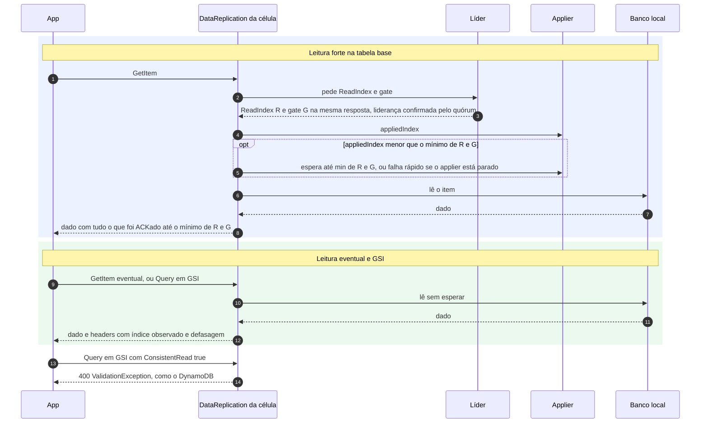

# C05 — Caminho feliz: leitura Strong e Eventual

**Status:** ✅ Atualizado (modelo v1, revisão crítica de 13/10/2026) · **ADRs:** [ADR-049](../../03_adr/ADR-049-barreira-da-leitura-forte-e-o-gate.md), [ADR-050](../../03_adr/ADR-050-gsi-nao-tem-leitura-forte.md), [ADR-023](../../03_adr/ADR-023-modos-de-escrita-e-leitura.md), [ADR-012](../../03_adr/ADR-012-sem-downgrade-strong-eventual.md), [ADR-024](../../03_adr/ADR-024-delete-real-ttl-local-gsi.md), [ADR-046](../../03_adr/ADR-046-gate-so-conta-progresso-validado-pelo-raft.md)

## Cenário

O padrão é leitura forte: `READ_MODE_DEFAULT=strong` (obrigatória), válido **só para a tabela base**. `ConsistentRead=true` na tabela base é sempre forte; ausente ou `false` segue o padrão. A leitura forte pede à líder o **ReadIndex e o gate** e espera o `appliedIndex` local alcançar **`min(ReadIndex, gate)`**. Um cliente só pode ter visto escritas já ACKadas, e toda escrita ACKada está abaixo do gate, então a leitura-do-que-escrevi continua garantida **sem depender da saúde da Azure**. A leitura eventual lê o banco local direto e informa a defasagem em headers. Em **GSI** a leitura é sempre eventual.

## Diagrama

## Etapas

1. **Forte, alvo:** a célula pede à líder o `ReadIndex`; a líder confirma com o quórum que ainda é líder e devolve R **e o gate G na mesma resposta**. Um gate antigo guardado na follower enfraqueceria a garantia, por isso nunca é reutilizado.
2. **Forte, barreira:** o `DataReplication` compara o `appliedIndex` local com `min(R, G)` e espera o applier, até o prazo da requisição. Como o apply é serial e depois do gate ([ADR-053](../../03_adr/ADR-053-eventual-sem-apply-paralelo-na-v1.md)), `applied` nunca passa do gate, e uma Azure lenta **não atrasa** a leitura forte.
3. **Forte, leitura:** lê o banco local e responde com todas as escritas ACKadas até `min(R, G)`.
4. **Líder recém-eleita:** só atende leitura forte depois de reconstruir o gate com progresso confirmado no termo novo ([ADR-029](../../03_adr/ADR-029-gate-monotonico-na-troca-de-lider.md), [ADR-046](../../03_adr/ADR-046-gate-so-conta-progresso-validado-pelo-raft.md)).
5. **Eventual:** lê o banco local sem falar com a líder e calcula a defasagem em entradas e em segundos; devolve `observedIndex` e a idade em headers HTTP que o SDK ignora.
6. **GSI:** `ConsistentRead=true` em `Query` de GSI é recusada com `ValidationException` (400), como no DynamoDB. Sem o parâmetro, a leitura em GSI é sempre eventual, com o header `x-dr-consistency: eventual`; `READ_MODE_DEFAULT=strong` não se aplica ([ADR-050](../../03_adr/ADR-050-gsi-nao-tem-leitura-forte.md)).
7. **Sem relógio:** a leitura forte usa ReadIndex e gate e nunca lease (X11), para não depender de relógio.

## Falhas e tratativas

- **Líder isolada que ainda não sabe que perdeu.** O ReadIndex exige quórum: sem ele a líder não responde.
- **Applier parado** (entrada venenosa, [C26](C26-entrada-venenosa.md)). O `appliedIndex` não chega ao alvo: a leitura forte do shard falha rápido com `503`, em vez de esperar até o prazo.
- **Query em GSI com leitura forte.** Recusada (item 6). Depois do failover há ainda uma assimetria: o índice do Cosmos é consistente por padrão e o do DynamoDB não; a aplicação não deve depender de nenhum dos dois ([X06](../complexos/X06-delete-ttl-gsi.md)).
- **Scan.** Não há snapshot entre páginas: dois Scans consecutivos podem divergir.
- **Prazo vence esperando o applier.** Erro recuperável (o SDK retenta).

## Pontos em aberto

- Leitura forte em células follower concentra ReadIndex na líder e soma ~1 RTT: [R16](../a_rever/R16-leitura-forte-em-celulas-follower.md).
- Leitura eventual na Azure durante a degradação pode ter defasagem de até a duração do lease (mais, se prorrogado); acima do limite é redirecionada à AWS ou recusada: [C28](C28-leitura-eventual-na-azure-defasada.md).
