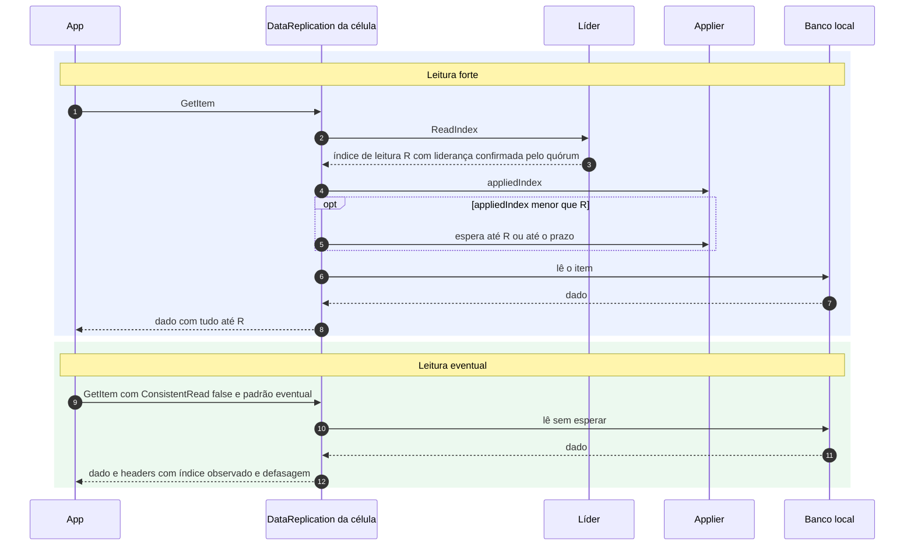

# C05 — Caminho feliz: leitura Strong e Eventual

**Status:** ✅ Atualizado (modelo v1) · **ADRs:** [ADR-023](../../03_adr/ADR-023-modos-de-escrita-e-leitura.md), [ADR-012](../../03_adr/ADR-012-sem-downgrade-strong-eventual.md), [ADR-024](../../03_adr/ADR-024-delete-real-ttl-local-gsi.md)

## Cenário

O padrão é leitura forte: `READ_MODE_DEFAULT=strong` (obrigatória). `ConsistentRead=true` é sempre forte; ausente ou `false` segue o padrão. A leitura forte pede um **ReadIndex** à líder e espera o `appliedIndex` local alcançá-lo. A leitura eventual lê o banco local direto e informa a defasagem em headers.

## Diagrama

## Etapas

1. **Forte, alvo:** a célula pede `ReadIndex` à líder; a líder confirma com o quórum que ainda é líder e devolve R.
2. **Forte, barreira:** o `DataReplication` compara o `appliedIndex` local com R e espera o applier, até o prazo da requisição.
3. **Forte, leitura:** lê o banco local e responde com todas as escritas confirmadas até R.
4. **Eventual:** lê o banco local sem falar com a líder e calcula a defasagem em entradas e em segundos; devolve `observedIndex` e a idade em headers HTTP que o SDK ignora.
5. **Sem relógio:** a leitura forte usa ReadIndex e nunca lease (X11), para não depender de relógio.

## Falhas e tratativas

- **Líder isolada que ainda não sabe que perdeu.** O ReadIndex exige quórum: sem ele a líder não responde.
- **Query em GSI com leitura forte.** Forte só até a propagação do índice (o DynamoDB não permite `ConsistentRead` em GSI). Ver [X06](../complexos/X06-delete-ttl-gsi.md).
- **Scan.** Não há snapshot entre páginas: dois Scans consecutivos podem divergir.
- **Prazo vence esperando o applier.** Erro recuperável (o SDK retenta).

## Pontos em aberto

- Leitura forte em células follower concentra ReadIndex na líder e soma ~1 RTT: [R16](../a_rever/R16-leitura-forte-em-celulas-follower.md).
- Leitura eventual na Azure durante a degradação pode ter horas de atraso; acima do limite é redirecionada à AWS ou recusada: [C28](C28-leitura-eventual-na-azure-defasada.md).
