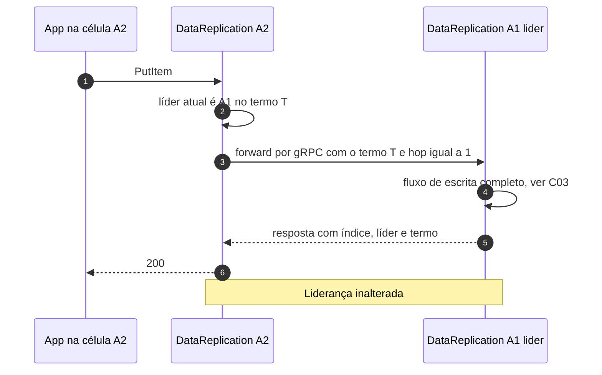

# C06 — Requisição chega numa célula que não é a líder

**Status:** ✅ Atualizado (modelo v1) · **ADRs:** [ADR-010](../../03_adr/ADR-010-follower-encaminha-para-lider.md)

## Cenário

O Compass-Router entrega a requisição a uma célula follower. O `DataReplication` dela **encaminha** a escrita à líder por gRPC (+1 a 2 ms) e devolve a resposta como se fosse local. A liderança não muda por requisição; ela só muda por eleição de saúde ou transferência planejada.

## Diagrama

## Etapas

1. A app chama o `DataReplication` local.
2. Ele consulta a líder e o termo conhecidos e encaminha a escrita à líder, marcando que já houve um salto.
3. A líder executa o fluxo de escrita (C03 ou C04).
4. A resposta volta com a líder e o termo atuais, para corrigir o cache da célula.

## Falhas e tratativas

- **Líder inalcançável e sem eleição concluída.** A follower devolve erro recuperável com `retryAfter`; nunca grava localmente.
- **Gateway mal configurado gera salto persistente.** Métrica `forwarded_writes_ratio` com alerta.
- **Loop de encaminhamento durante a eleição.** Decidido: limite de 1 salto e espera de até 1 s pela líder, depois `503`. Ver [C27](C27-encaminhamento-sem-lider-conhecida.md).
