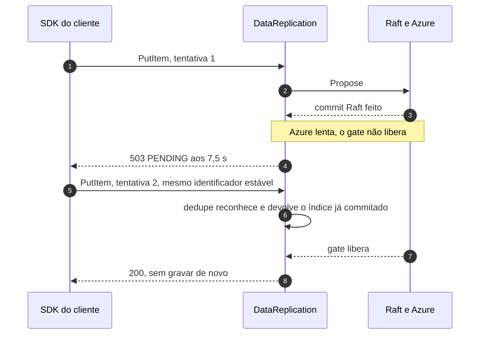
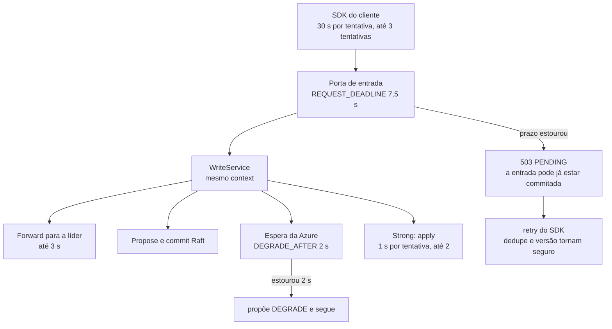

# C07 — Prazo estoura depois do commit, antes do ACK (retry do SDK)

**Status:** ✅ Atualizado (modelo v1) · **ADRs:** [ADR-026](../../03_adr/ADR-026-dedupe-de-retry-id-estavel.md), [ADR-028](../../03_adr/ADR-028-timeouts-em-cascata.md) · **Relacionados:** [X05 Timeouts e idempotência](../complexos/X05-timeouts-e-idempotencia.md)

## Cenário

A escrita foi commitada pelo Raft, mas o gate (ou o apply, no Strong) ainda não terminou e o prazo da requisição (`REQUEST_DEADLINE`, 7,5 s) acaba. O `DataReplication` responde `503 PENDING`, que o SDK retenta. O SDK tem 30 s por tentativa e no máximo 3 tentativas. O retry **não pode duplicar** a escrita.

## Diagrama

## Diagrama: prazos em cascata

## Etapas

1. **Commit sem gate:** o Raft commitou, mas a Azure está lenta e o gate não avança.
2. **Prazo:** aos 7,5 s o servidor responde `503 PENDING`; a escrita não se perde.
3. **Retry:** o SDK repete com o mesmo identificador estável.
4. **Dedupe:** a líder reconhece a repetição e devolve o índice já commitado, sem entrada nova.
5. **Janela:** 5 min, para cobrir 3 tentativas de 30 s no pior caso (cerca de 90 a 130 s com o servidor mudo).

## Falhas e tratativas

- **SDK sem identificador estável.** O hash de tabela, chave e conteúdo é o último recurso, com falso positivo possível em escritas legítimas iguais.
- **Aplicação retenta por cima do SDK.** O retry cai fora da janela de 5 min. Se existir em algum cliente, a janela precisa crescer.
- **Cascata fora de ordem.** A partida recusa subir se `DEGRADE_AFTER >= REQUEST_DEADLINE` ou `REQUEST_DEADLINE >= CLIENT_TIMEOUT`.
- **Conexão ociosa fechada pelo servidor.** `IdleTimeout` de 120 s, maior que o idle dos SDKs, para o SDK não reusar conexão já fechada.

## Pontos em aberto

- Memória da janela de dedupe de 5 min (~58 MiB): [R22](../a_rever/R22-memoria-da-janela-de-dedupe.md).
- Lote do `BatchWriteItem` (uma entrada, dedupe pelo id da requisição): [C23](C23-batchwriteitem-lote-uma-entrada.md).
- Valores de 7,5 s e 2 s ainda a validar em teste.
