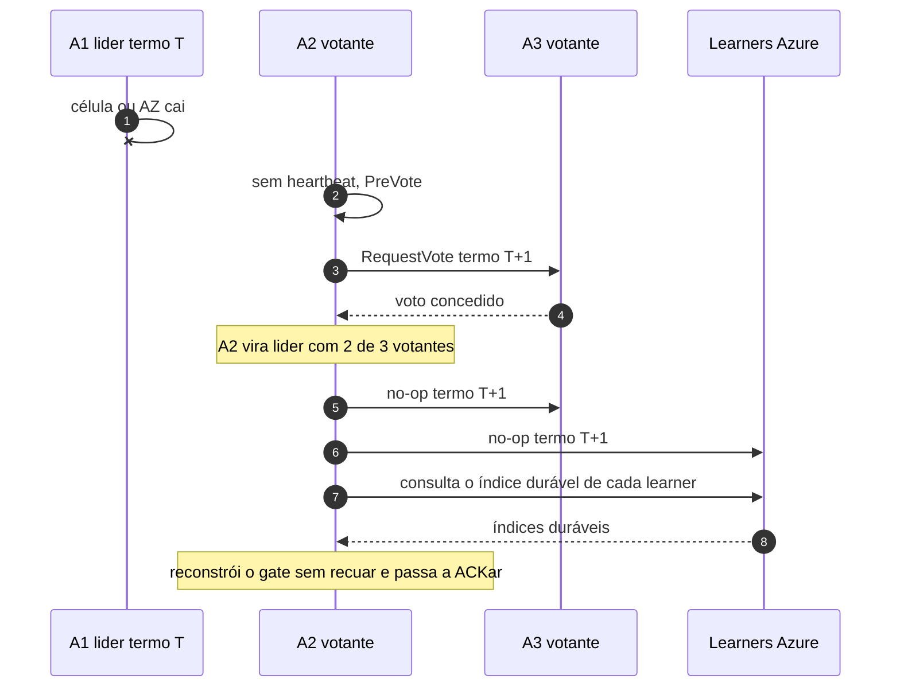

# C08 — Queda da célula líder ou de uma AZ na AWS

**Status:** ✅ Atualizado (modelo v1) · **ADRs:** [ADR-006](../../03_adr/ADR-006-consenso-por-shard-eleicao-na-aws.md), [ADR-029](../../03_adr/ADR-029-gate-monotonico-na-troca-de-lider.md), [ADR-017](../../03_adr/ADR-017-azure-learners-e-gate.md) · **Relacionados:** [X01 Gate e troca de líder](../complexos/X01-gate-e-troca-de-lider.md)

## Cenário

A célula líder A1 (ou a AZ dela) cai. Os votantes A2 e A3 são maioria: um deles vence a eleição no termo T+1. Escritas sem commit são descartadas e o cliente retenta. Tudo que estava confirmado está em A2 ou A3 e na maioria da Azure. **A líder nova só ACKa depois de reconstruir o gate** (ADR-029). RPO = 0, com pausa de escrita igual ao timeout de eleição mais a reconstrução (meta de 3 a 4 s, a medir).

## Diagrama

## Etapas

1. **Falha:** a célula líder cai.
2. **Detecção:** A2 deixa de receber heartbeat e inicia PreVote.
3. **Eleição:** A3 concede o voto porque o log de A2 é elegível; A2 vira líder no termo T+1.
4. **Afirmação:** A2 grava um no-op do novo termo nos votantes e nos learners.
5. **Gate:** A2 consulta os 3 learners e adota o 2º maior índice durável; o gate nunca recua.
6. **Retomada:** A2 passa a ACKar e libera o applier. As respostas informam a nova líder e o termo.

## Falhas e tratativas

- **Líder oscilando (eleições repetidas).** PreVote e CheckQuorum. Um nó com rede instável não derruba a liderança sozinho.
- **Duas AZs da AWS caem.** Sem maioria na AWS o shard para: [R06](../a_rever/R06-duas-azs-aws-caem.md).
- **Líder lenta mas viva.** Heartbeat saudável com disco ruim: o watchdog de fsync transfere a liderança. O critério completo é a hipótese [R23](../a_rever/R23-hipoteses-gerais.md).
