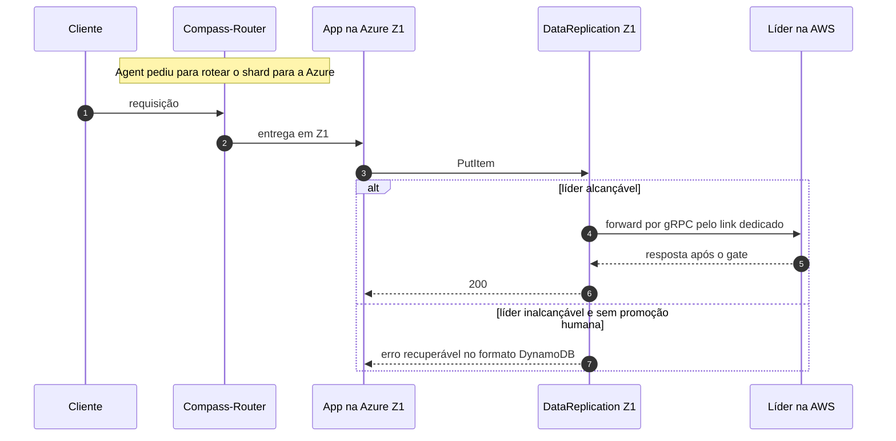

# C10 — Apps da AWS fora, replicação viva: tráfego vai para a Azure

**Status:** ✅ Atualizado (modelo v1) · **ADRs:** [ADR-010](../../03_adr/ADR-010-follower-encaminha-para-lider.md), [ADR-033](../../03_adr/ADR-033-promocao-da-azure-humana.md)

## Cenário

As células de aplicação da AWS falham, mas a camada de replicação e a líder continuam vivas. O Agent pede ao Compass-Router para mandar o tráfego à Azure. O `DataReplication` da Azure **encaminha** as escritas à líder na AWS pelo link dedicado. Se não alcança a líder, devolve erro recuperável e **nunca escreve localmente**. RPO = 0, sem promoção e sem risco de split-brain.

## Diagrama

## Etapas

1. O Agent manda rotear o shard para a Azure.
2. A app em Z1 chama o `DataReplication` local.
3. Ele encaminha à líder AWS (1 salto) pelo link dedicado.
4. A líder executa a escrita completa (C03 ou C04) e responde.
5. Se a líder não for alcançável, o erro é recuperável; nenhuma escrita local.

## Falhas e tratativas

- **O link vira caminho quente.** Cada escrita cruza o link duas vezes (forward e replicação). Dimensionar e considerar QoS ([C25](C25-link-lento-faixa-cinzenta.md)).
- **Router manda tráfego à Azure com o link fora.** O `DataReplication` responde erro recuperável e nunca escreve localmente. Dependência externa registrada.
