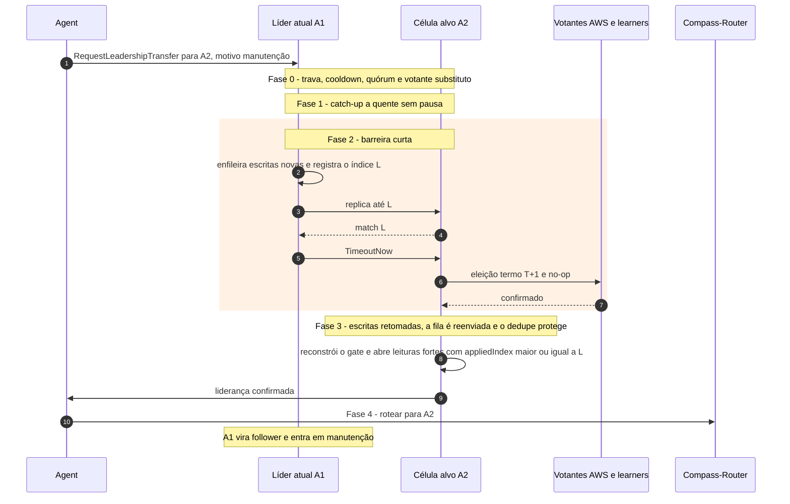

# C11 — Transferência planejada de liderança (manutenção)

**Status:** ✅ Atualizado (modelo v1) · **ADRs:** [ADR-013](../../03_adr/ADR-013-transferencia-planejada-de-lideranca.md), [ADR-010](../../03_adr/ADR-010-follower-encaminha-para-lider.md)

## Cenário

Uma célula vai entrar em manutenção (uma por vez). O Agent dispara a transferência. A sincronização pesada acontece **antes** da pausa; a pausa dura cerca de 1 RTT (meta de 50 ms, janela de exceção fora do P99). As escritas voltam quando a nova líder confirma o no-op; as leituras fortes esperam o banco da célula nova aplicar tudo. O roteamento muda por último. RPO = 0. Detalhes das 5 fases no [ADR-013](../../03_adr/ADR-013-transferencia-planejada-de-lideranca.md).

## Diagrama

## Etapas

1. **Pedido:** o Agent pede a transferência para A2. Fase 0 confere trava por shard, cooldown, quórum e votante substituto (add-then-remove).
2. **Fase 1:** A2 alcança o log e o apply até o lag ficar abaixo do limiar, sem pausa.
3. **Fase 2:** A1 enfileira escritas novas, replica até L e envia `TimeoutNow`; A2 vence a eleição no termo T+1 e grava o no-op.
4. **Fase 3:** as escritas voltam em A2 e a fila é reenviada; o dedupe evita duplicação. A2 reconstrói o gate (ADR-029).
5. **Fase 4:** o Agent roteia para A2; A1 vira follower e entra em manutenção.

## Falhas e tratativas

- **Célula alvo cai durante a barreira.** Limite da pausa (ex.: 200 ms) com aborto; se o `TimeoutNow` ainda não foi enviado, a líder antiga retoma.
- **Link AWS↔Azure cai no meio.** Sem a maioria da Azure a nova líder não confirma o no-op e a transferência aborta.
- **Duas transferências ao mesmo tempo.** Trava por shard e cooldown na Fase 0.

## Pontos em aberto

- Critério de "líder degradada" para disparar a transferência automática: [R23](../a_rever/R23-hipoteses-gerais.md).
