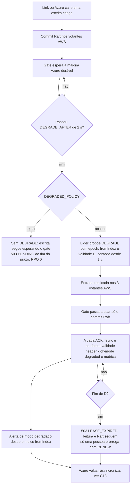

# C12 — Link AWS↔Azure cai ou Azure cai: modo degradado com lease

**Status:** ✅ Atualizado (modelo v1, revisão crítica de 13/10/2026); o valor de D depende da PEND-02 · **ADRs:** [ADR-014](../../03_adr/ADR-014-modo-degradado-opcao-b.md), [ADR-044](../../03_adr/ADR-044-lease-do-modo-degradado-e-promocao-da-azure.md), [ADR-045](../../03_adr/ADR-045-politica-de-degradacao-por-instalacao.md), [ADR-027](../../03_adr/ADR-027-sinalizacao-do-modo-degradado.md), [ADR-028](../../03_adr/ADR-028-timeouts-em-cascata.md), [ADR-017](../../03_adr/ADR-017-azure-learners-e-gate.md) · **Relacionados:** [C32](C32-particao-e-lease-do-modo-degradado.md), [X02 Modo degradado](../complexos/X02-modo-degradado.md)

## Cenário

A Azure fica inalcançável, por queda do link ou da própria Azure (da AWS os dois casos são iguais). As escritas esperam o gate. O que acontece depois depende da variável obrigatória `DEGRADED_POLICY`, definida por instalação e sem valor padrão:

- **`accept`:** passados `DEGRADE_AFTER` (2 s), a líder propõe a entrada replicada `DEGRADE(epoch, fromIndex, validade D)` nos 3 votantes AWS (D conta desde o último contato com a maioria Azure, `t_c`, e não desde a proposta); o gate passa a usar só o commit do Raft e as escritas em espera são ACKadas **com o header `x-dr-mode: degraded`**. RPO > 0, **limitado no tempo pelo lease D** (`DEGRADED_LEASE`, valor a definir com o aceite formal do RPO, PEND-02). A líder confere a validade a cada ACK; ao fim de D a AWS responde `503 LEASE_EXPIRED` a escritas, e só uma pessoa prorroga (entrada replicada `RENEW`).
- **`reject`:** a líder nunca propõe `DEGRADE`. Sem o gate da Azure a escrita não é ACKada: o cliente recebe `503 PENDING` (resultado desconhecido) e o RPO é 0 sempre. A recomendação para dados monetários que não aceitam RPO > 0.

O header **não é o aceite de risco** (os SDKs o ignoram); o aceite é a política. A Azure **não** se promove sozinha, e a promoção humana só é aceita depois de D + M ([C32](C32-particao-e-lease-do-modo-degradado.md)).

## Diagrama

## Etapas

1. **Falha:** o link ou a Azure cai. Escritas commitam na AWS e aguardam o gate.
2. **Decisão:** passados 2 s (menor que o prazo da requisição, para não estourar tudo antes da degradação), com `accept` a líder propõe `DEGRADE` carregando a validade D, contada no relógio monotônico da líder desde o **último contato com a maioria dos learners da Azure** (`t_c`), e não desde a proposta. Se a proposta sair muito depois de `t_c`, o lease já nasce vencido. Com `reject`, nada é proposto.
3. **Mudança de regra (`accept`):** o gate passa a ser o commit Raft; as escritas em espera saem com o header de modo degradado e a métrica `degraded_mode`.
4. **Lease:** a validade é conferida a cada ACK, depois do fsync e antes de responder, e não apenas em um temporizador. Ao fim de D vem `503 LEASE_EXPIRED`; o alerta de lease chegando ao fim dispara com antecedência (limiar a definir).
5. **Alerta:** a operação é avisada do modo degradado desde o índice `fromIndex`.
6. **Células Azure:** respondem erro recuperável ou leitura eventual defasada com a defasagem informada ([C28](C28-leitura-eventual-na-azure-defasada.md)).
7. **Saída:** a volta da Azure leva à ressincronização e ao `RESTORE` ([C13](C13-ressincronizacao-da-azure.md)).

## Falhas e tratativas

- **Fim de D com a Azure ainda fora.** As escritas param (`503 LEASE_EXPIRED`) mesmo sem a Azure ter voltado: a disponibilidade em degradado é finita, por desenho. Saídas: a Azure voltar e ressincronizar, uma pessoa prorrogar, ou a promoção da Azure depois de D + M. A prorrogação x promoção é a hipótese H-DR13, a fechar no TLA+ ([C32](C32-particao-e-lease-do-modo-degradado.md)).
- **Pausa de processo ou salto de relógio.** Por isso a conferência a cada ACK; salto detectado conta como lease expirado.
- **Disco do log esgota durante degradação longa.** A retenção para a Azure tem teto de 70% do volume; passado o teto, a Azure vira "fora da janela" e precisará de reconstrução completa. Prefere-se perder a elegibilidade da Azure a derrubar o disco da AWS (04_wal_e_fsync 6.5). Sem descarga para S3 na v1 ([ADR-041](../../03_adr/ADR-041-disco-do-log-teto-de-70-por-cento-sem-s3-na-v1.md)): [C29](C29-disco-do-log-em-degradacao-longa.md). D é o que dimensiona esse volume.
- **Partição assimétrica (a Azure recebe, mas as confirmações não voltam).** A AWS entra em modo degradado e a Azure continua vendo contato recente, então não libera a promoção. A Azure ter dados a mais não causa dano; a ressincronização acerta a diferença. Hipótese H-DR14, a modelar.
- **Link oscilando (flapping).** Histerese na saída é a proposta; ainda a revisar: [R07](../a_rever/R07-link-oscilando.md). Cada `DEGRADE` novo conta o lease desde o `t_c` do novo episódio.
- **`reject` e disponibilidade.** Uma queda da Azure ou do link para as escritas do cliente (disponibilidade menor, RPO 0). A política é testada nos dois valores na suíte de falhas.

## Pontos em aberto

- Aceite formal do RPO > 0 e do valor de D (PEND-02, **bloqueante** para instalações `accept`): [R23 H2](../a_rever/R23-hipoteses-gerais.md).
- Link lento sem cair não dispara a degradação: [C25](C25-link-lento-faixa-cinzenta.md).
