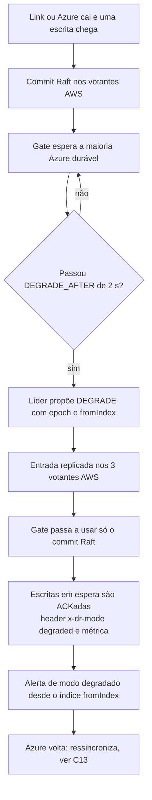

# C12 — Link AWS↔Azure cai ou Azure cai: modo degradado

**Status:** ✅ Atualizado (modelo v1) · **ADRs:** [ADR-014](../../03_adr/ADR-014-modo-degradado-opcao-b.md), [ADR-027](../../03_adr/ADR-027-sinalizacao-do-modo-degradado.md), [ADR-028](../../03_adr/ADR-028-timeouts-em-cascata.md), [ADR-017](../../03_adr/ADR-017-azure-learners-e-gate.md) · **Relacionados:** [X02 Modo degradado](../complexos/X02-modo-degradado.md)

## Cenário

A Azure fica inalcançável, por queda do link ou da própria Azure (da AWS os dois casos são iguais). As escritas esperam o gate. Passados `DEGRADE_AFTER` (2 s), a líder propõe a entrada replicada `DEGRADE(epoch, fromIndex)` nos 3 votantes AWS; o gate passa a usar só o commit do Raft e as escritas em espera são ACKadas **com o header `x-dr-mode: degraded`**. RPO > 0, proporcional à duração (aceite formal pendente: PEND-02). A Azure **não** se promove sozinha.

## Diagrama

## Etapas

1. **Falha:** o link ou a Azure cai. Escritas commitam na AWS e aguardam o gate.
2. **Decisão:** passados 2 s (menor que o prazo da requisição, para não estourar tudo antes da degradação), a líder propõe `DEGRADE`.
3. **Mudança de regra:** o gate passa a ser o commit Raft; as escritas em espera saem com o header de modo degradado e a métrica `degraded_mode`.
4. **Alerta:** a operação é avisada do modo degradado desde o índice `fromIndex`.
5. **Células Azure:** respondem erro recuperável ou leitura eventual defasada com a defasagem informada.

## Falhas e tratativas

- **Disco do log esgota durante degradação longa.** A retenção para a Azure tem teto de 70% do volume; passado o teto, a Azure vira "fora da janela" e precisará de reconstrução completa. Prefere-se perder a elegibilidade da Azure a derrubar o disco da AWS (04_wal_e_fsync 6.5). Sem descarga para S3 na v1 ([ADR-041](../../03_adr/ADR-041-disco-do-log-teto-de-70-por-cento-sem-s3-na-v1.md)): [C29](C29-disco-do-log-em-degradacao-longa.md).
- **Partição assimétrica (a Azure recebe, mas as confirmações não voltam).** A AWS entra em modo degradado. A Azure ter dados a mais não causa dano; a ressincronização acerta a diferença.
- **Link oscilando (flapping).** Histerese na saída é a proposta; ainda a revisar: [R07](../a_rever/R07-link-oscilando.md).

## Pontos em aberto

- RPO > 0 sem teto (aceite formal): [R23 H2](../a_rever/R23-hipoteses-gerais.md) e PEND-02, **bloqueante**.
- Link lento sem cair não dispara a degradação: [C25](C25-link-lento-faixa-cinzenta.md).
