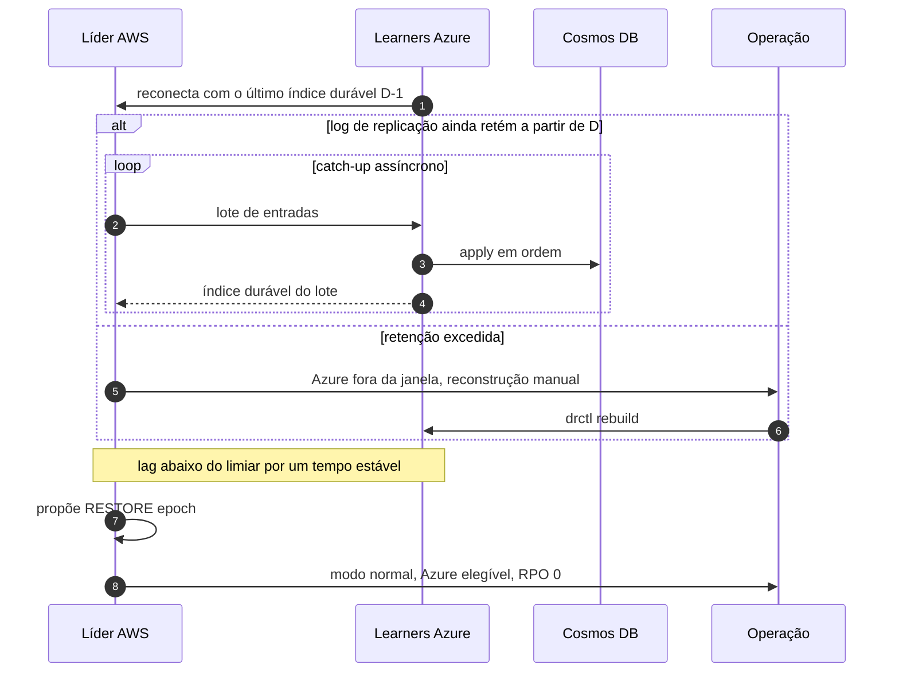

# C13 — Ressincronização da Azure

**Status:** ✅ Atualizado (modelo v1) · **ADRs:** [ADR-014](../../03_adr/ADR-014-modo-degradado-opcao-b.md), [ADR-018](../../03_adr/ADR-018-dois-logs-raft-e-replicacao.md), [ADR-034](../../03_adr/ADR-034-fsync-fatal-e-identidade-nova.md) · **Relacionados:** [X02 Modo degradado](../complexos/X02-modo-degradado.md)

## Cenário

A Azure (ou o link) volta. Os learners pedem as entradas a partir do último índice durável que têm, e o catch-up é assíncrono. Com o lag abaixo do limiar e histerese, a líder propõe `RESTORE(epoch)` e o gate volta a exigir a maioria Azure. Se a retenção do log na AWS não cobrir o período, a Azure precisa de reconstrução manual assistida (`drctl rebuild`).

## Diagrama

## Etapas

1. Os learners reconectam informando o último índice durável.
2. Se o log de replicação ainda tem as entradas, a líder as envia em lotes; a Azure grava e aplica no Cosmos em ordem.
3. Se a retenção foi excedida, a Azure é marcada fora da janela e a reconstrução é manual.
4. Com o lag abaixo do limiar de forma estável (histerese), a líder propõe `RESTORE`.
5. O RPO volta a 0 e a Azure volta a ser elegível para promoção.

## Falhas e tratativas

- **Catch-up mais lento que a entrada nova.** O catch-up do log (em bytes) é rápido e é o único que bloqueia o RESTORE. O atraso de apply no Cosmos não bloqueia o RESTORE, mas afeta o RTO: [R03](../a_rever/R03-backlog-de-apply-no-cosmos.md).
- **Azure não alcança a AWS.** Parcialmente tratado: [R09](../a_rever/R09-resincronizacao-lenta-ou-bloqueada.md).

## Pontos em aberto

- Reconstrução automática de réplica (H-DR1): [R23](../a_rever/R23-hipoteses-gerais.md).
