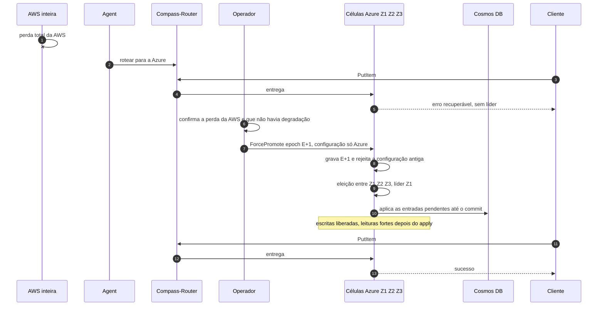

# C14 — AWS cai por inteiro sem degradação prévia

**Status:** ✅ Atualizado (modelo v1); decisão humana pendente de PEND-01 · **ADRs:** [ADR-033](../../03_adr/ADR-033-promocao-da-azure-humana.md), [ADR-017](../../03_adr/ADR-017-azure-learners-e-gate.md) · **Relacionados:** [X03 Desastre e promoção](../complexos/X03-desastre-e-promocao-da-azure.md)

## Cenário

A AWS cai inteira com o shard em modo normal. Como toda entrada confirmada já estava na maioria Azure (gate), **nada confirmado se perde (RPO = 0)**. O Compass-Router já leva o tráfego à Azure, mas as células Azure respondem erro recuperável até que **uma pessoa** promova a Azure (`ForcePromote`, nova epoch). A promoção grava a epoch E+1 e uma configuração só com a Azure, que rejeita para sempre a antiga; os learners viram votantes, elegem a líder e aplicam o que faltar no Cosmos antes de abrir as leituras fortes.

## Diagrama

## Etapas

1. **Desastre:** a AWS cai inteira.
2. **Rota:** o Agent roteia para a Azure; as escritas recebem erro recuperável, pois não há líder.
3. **Diagnóstico humano:** o operador confirma a perda da AWS e que não havia degradação (checklist de evidências independentes).
4. **Promoção:** `ForcePromote` com epoch E+1 e configuração só com a Azure; a configuração antiga é revogada.
5. **Eleição:** Z1, Z2 e Z3 elegem a líder. O procedimento escolhe o log por (termo, índice) e trata entradas replicadas mas nunca commitadas.
6. **Apply pendente:** a Azure aplica no Cosmos tudo até o commit; as escritas liberam e as leituras fortes abrem depois.
7. **Retomada:** novas escritas são confirmadas na Azure. RPO 0 para o que foi confirmado antes da perda.

## Falhas e tratativas

- **Operador indisponível ou lento.** O RTO inclui detectar, decidir e executar: [R10](../a_rever/R10-operador-lento-no-desastre.md).
- **A API de promoção depende de algo que estava na AWS.** Princípio: sem dependência circular de uma nuvem perdida. Falta o teste com a AWS bloqueada: [R11](../a_rever/R11-api-de-promocao-depende-da-aws.md).
- **Promoção com a AWS viva (diagnóstico errado).** Split-brain, sem resolução: [R12](../a_rever/R12-promocao-com-aws-viva.md).
