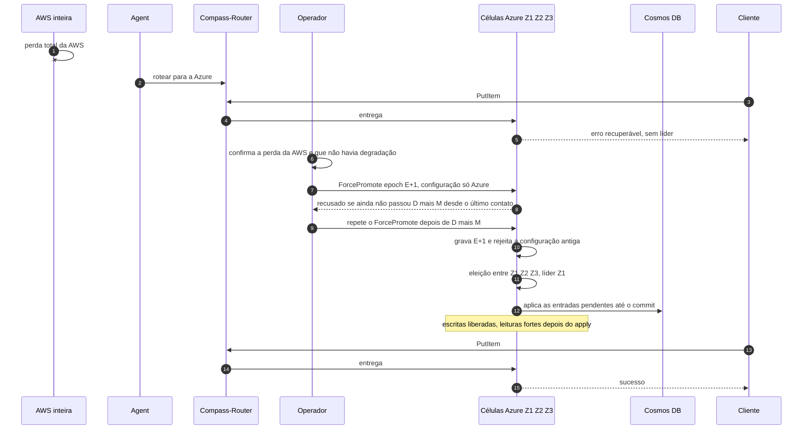

# C14 — AWS cai por inteiro sem degradação prévia

**Status:** ✅ Atualizado (modelo v1, revisão crítica de 13/10/2026); promoção humana e só depois de D + M; a PEND-01 fecha quando D e M forem aprovados e o TLA+ provar a regra · **ADRs:** [ADR-033](../../03_adr/ADR-033-promocao-da-azure-humana.md), [ADR-044](../../03_adr/ADR-044-lease-do-modo-degradado-e-promocao-da-azure.md), [ADR-045](../../03_adr/ADR-045-politica-de-degradacao-por-instalacao.md), [ADR-017](../../03_adr/ADR-017-azure-learners-e-gate.md) · **Relacionados:** [C32](C32-particao-e-lease-do-modo-degradado.md), [X03 Desastre e promoção](../complexos/X03-desastre-e-promocao-da-azure.md)

## Cenário

A AWS cai inteira com o shard em modo normal. Como toda entrada confirmada já estava na maioria Azure (gate), **nada confirmado se perde (RPO = 0)**. O Compass-Router já leva o tráfego à Azure, mas as células Azure respondem erro recuperável até que **uma pessoa** promova a Azure (`ForcePromote`, nova epoch), o que o software só aceita **depois de D + M** contados desde o último contato recebido da AWS: da Azure, uma AWS morta e um link caído são idênticos, e a AWS pode ter entrado em degradado depois desse contato, com o lease contado desde o último contato com a maioria Azure ([C32](C32-particao-e-lease-do-modo-degradado.md)). A promoção grava a epoch E+1 e uma configuração só com a Azure, que rejeita para sempre a antiga; os learners viram votantes, elegem a líder e aplicam o que faltar no Cosmos antes de abrir as leituras fortes.

## Diagrama

## Etapas

1. **Desastre:** a AWS cai inteira.
2. **Rota:** o Agent roteia para a Azure; as escritas recebem erro recuperável, pois não há líder.
3. **Diagnóstico humano:** o operador confirma a perda da AWS e que não havia degradação (checklist de evidências independentes).
4. **Espera de D + M:** a API `ForcePromote` recusa antes de D + M desde o último contato recebido da AWS. Com `DEGRADED_POLICY=accept`, o **RTO é pelo menos D + M**, mesmo que a AWS não estivesse degradada. Com `reject` não há lease: a promoção se apoia na maioria Azure já estar na epoch nova (fencing por maioria, a provar no modelo).
5. **Promoção:** `ForcePromote` com epoch E+1 e configuração só com a Azure; a configuração antiga é revogada.
6. **Eleição:** Z1, Z2 e Z3 elegem a líder. O procedimento escolhe o log por (termo, índice) e trata entradas replicadas mas nunca commitadas.
7. **Apply pendente:** a Azure aplica no Cosmos tudo até o commit; as escritas liberam e as leituras fortes abrem depois.
8. **Retomada:** novas escritas são confirmadas na Azure. RPO 0 para o que foi confirmado antes da perda.

## Falhas e tratativas

- **Operador indisponível ou lento.** O RTO inclui detectar, decidir, esperar D + M e executar: [R10](../a_rever/R10-operador-lento-no-desastre.md). O RTO é uma distribuição medida em exercícios de falha (mediana, P95 e pior caso), não uma soma de percentis de etapas ([R18](../a_rever/R18-rto-nao-quantificado.md)).
- **A API de promoção depende de algo que estava na AWS.** Princípio: sem dependência circular de uma nuvem perdida. Falta o teste com a AWS bloqueada: [R11](../a_rever/R11-api-de-promocao-depende-da-aws.md).
- **Promoção com a AWS viva (diagnóstico errado).** Com o lease, a AWS viva já parou de aceitar escrita ao fim de D, antes de a Azure poder ser promovida; o risco que sobra é de relógio (deriva e pausa, parcelas de M) e da prorrogação x promoção (H-DR13). A regra ainda precisa ser provada no TLA+: [R12](../a_rever/R12-promocao-com-aws-viva.md), [C32](C32-particao-e-lease-do-modo-degradado.md).
