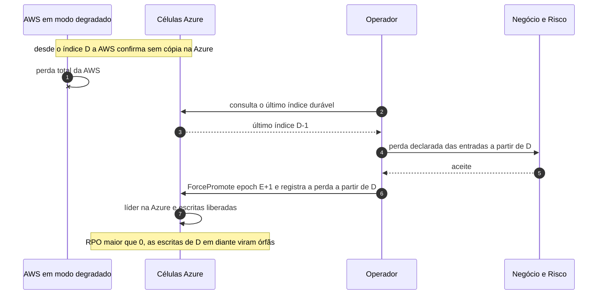

# C15 — AWS cai durante o modo degradado

**Status:** ✅ Atualizado (modelo v1); perda declarada · **ADRs:** [ADR-014](../../03_adr/ADR-014-modo-degradado-opcao-b.md), [ADR-033](../../03_adr/ADR-033-promocao-da-azure-humana.md) · **Relacionados:** [X03 Desastre e promoção](../complexos/X03-desastre-e-promocao-da-azure.md)

## Cenário

O link ou a Azure já estava fora, a AWS escrevia em modo degradado desde o índice D, e então a AWS cai. As entradas de D em diante só existem na AWS. Para retomar o negócio, o operador promove a Azure **declarando a perda** dessa janela: **RPO > 0**. Essas escritas viram **órfãs** (reconciliação em aberto: R13).

## Diagrama

## Etapas

1. Com a AWS em degradação desde D, a AWS cai.
2. O operador consulta na Azure o último índice durável (D-1).
3. O negócio e o risco aceitam formalmente a perda das entradas de D em diante.
4. O operador promove a Azure com a epoch E+1 e registra a perda.
5. A Azure elege a líder e libera as escritas; as de D em diante são órfãs.

## Falhas e tratativas

- **Escritas órfãs sem processo de reconciliação.** Sem resolução: [R13](../a_rever/R13-escritas-orfas-reconciliacao.md).

## Pontos em aberto

- PEND-02 (aceite formal do RPO > 0) é pré-requisito deste cenário.
