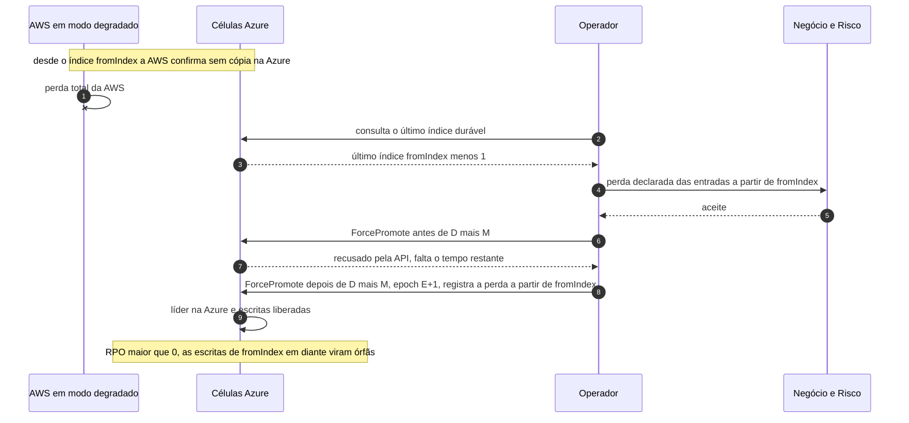

# C15 — AWS cai durante o modo degradado

**Status:** ✅ Atualizado (modelo v1); perda declarada · **ADRs:** [ADR-014](../../03_adr/ADR-014-modo-degradado-opcao-b.md), [ADR-044](../../03_adr/ADR-044-lease-do-modo-degradado-e-promocao-da-azure.md), [ADR-033](../../03_adr/ADR-033-promocao-da-azure-humana.md) · **Relacionados:** [C32](C32-particao-e-lease-do-modo-degradado.md), [X03 Desastre e promoção](../complexos/X03-desastre-e-promocao-da-azure.md)

## Cenário

O link ou a Azure já estava fora, a AWS escrevia em modo degradado desde o índice `fromIndex`, e então a AWS cai. As entradas de `fromIndex` em diante só existem na AWS. Para retomar o negócio, o operador promove a Azure **declarando a perda** dessa janela: **RPO > 0**. Essas escritas viram **órfãs** (reconciliação em aberto: R13). Com o lease do [ADR-044](../../03_adr/ADR-044-lease-do-modo-degradado-e-promocao-da-azure.md), a janela de órfãs tem um teto, **D** contado desde o último contato com a maioria Azure (a AWS para de ACKar ao fim dele), e a promoção só é aceita **depois de D + M** desde o último contato com a AWS. **O RTO deste cenário é, portanto, pelo menos D + M.**

## Diagrama

## Etapas

1. Com a AWS em degradação desde `fromIndex`, a AWS cai.
2. O operador consulta na Azure o último índice durável (`fromIndex` menos 1).
3. O negócio e o risco aceitam formalmente a perda das entradas de `fromIndex` em diante (o aceite de D vem da PEND-02).
4. Passados D + M desde o último contato com a AWS, o operador promove a Azure com a epoch E+1 e registra a perda. Antes disso a API `ForcePromote` recusa.
5. A Azure elege a líder e libera as escritas; as de `fromIndex` em diante são órfãs.

## Falhas e tratativas

- **Escritas órfãs sem processo de reconciliação.** Sem resolução: [R13](../a_rever/R13-escritas-orfas-reconciliacao.md).
- **Lease já vencido quando a AWS cai.** A AWS já tinha parado de ACKar ao fim de D; o que existe só na AWS são as escritas ACKadas dentro de D, mais entradas commitadas e nunca confirmadas ao cliente (`503 LEASE_EXPIRED`), tratadas como resultado desconhecido.
- **Prorrogação em curso.** Uma pessoa pode ter prorrogado o lease (`RENEW`) antes da queda; as órfãs passam de D e a promoção espera o novo prazo. A regra de prorrogação x promoção é a hipótese H-DR13.

## Pontos em aberto

- PEND-02 (aceite formal do RPO > 0 e do valor de D) é pré-requisito deste cenário.
- Só vale para instalações `DEGRADED_POLICY=accept`; com `reject` o shard não chega a este estado ([ADR-045](../../03_adr/ADR-045-politica-de-degradacao-por-instalacao.md)).
