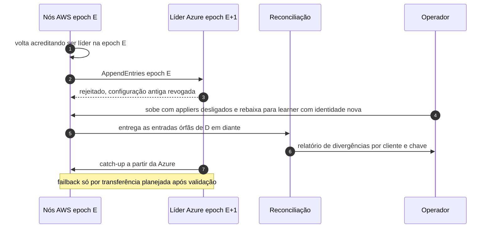

# C16 — AWS volta depois da promoção da Azure

**Status:** ✅ Atualizado (fluxo principal); fencing do banco em revisão · **ADRs:** [ADR-033](../../03_adr/ADR-033-promocao-da-azure-humana.md), [ADR-034](../../03_adr/ADR-034-fsync-fatal-e-identidade-nova.md) · **Relacionados:** [X03 Desastre e promoção](../complexos/X03-desastre-e-promocao-da-azure.md)

## Cenário

A AWS volta depois que a Azure foi promovida. Os nós da AWS ainda estão na epoch antiga e tentam liderar ou escrever, mas as células Azure **rejeitam** a configuração antiga. Os nós AWS entram como learners (identidade nova), fazem catch-up a partir da Azure e entregam as escritas órfãs para reconciliação. O failback é uma transferência planejada posterior.

## Diagrama

## Etapas

1. A AWS volta e seus nós ainda acreditam estar na epoch E.
2. Qualquer tentativa de replicar na epoch E é rejeitada pela Azure.
3. O operador sobe os nós AWS com os appliers desligados, como learners de identidade nova.
4. As escritas órfãs vão para a reconciliação, que produz um relatório.
5. A AWS faz catch-up pela Azure. O failback acontece depois, por transferência planejada.

## Falhas e tratativas

- **Banco da AWS que volta contém órfãs e o fencing por item não barra o applier antigo.** Tratado com boot cercado, revogação de credenciais e recriação da célula: [C30](C30-aws-que-volta-boot-cercado.md). Cada célula AWS tem o seu banco, e cada um pode conter órfãs.
