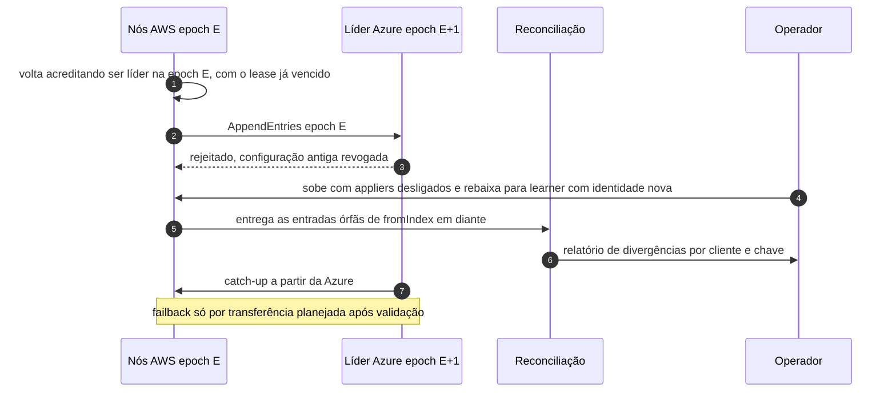

# C16 — AWS volta depois da promoção da Azure

**Status:** ✅ Atualizado (fluxo principal, revisão crítica de 13/10/2026); fencing do banco decidido em C30 · **ADRs:** [ADR-033](../../03_adr/ADR-033-promocao-da-azure-humana.md), [ADR-044](../../03_adr/ADR-044-lease-do-modo-degradado-e-promocao-da-azure.md), [ADR-042](../../03_adr/ADR-042-aws-que-volta-boot-cercado-e-recriacao-da-celula.md), [ADR-034](../../03_adr/ADR-034-fsync-fatal-e-identidade-nova.md) · **Relacionados:** [C32](C32-particao-e-lease-do-modo-degradado.md), [C30](C30-aws-que-volta-boot-cercado.md), [X03 Desastre e promoção](../complexos/X03-desastre-e-promocao-da-azure.md)

## Cenário

A AWS volta depois que a Azure foi promovida. Como a promoção só foi aceita depois de D + M ([ADR-044](../../03_adr/ADR-044-lease-do-modo-degradado-e-promocao-da-azure.md)), a AWS antiga já tinha parado de aceitar escrita por conta própria (`503 LEASE_EXPIRED`) antes de a Azure aceitar a primeira; por isso não há duas pontas escrevendo. Os nós da AWS ainda estão na epoch antiga e tentam liderar ou escrever, mas as células Azure **rejeitam** a configuração antiga. Os nós AWS entram como learners (identidade nova), fazem catch-up a partir da Azure e entregam as escritas órfãs para reconciliação. O failback é uma transferência planejada posterior.

## Diagrama

## Etapas

1. A AWS volta e seus nós ainda acreditam estar na epoch E.
2. Qualquer tentativa de replicar na epoch E é rejeitada pela Azure; o lease vencido já impedia a AWS de ACKar. O lease cobre a **escrita nas duas pontas**; o banco que volta continua exigindo o fencing do [C30](C30-aws-que-volta-boot-cercado.md).
3. O operador sobe os nós AWS com os appliers desligados, como learners de identidade nova.
4. As escritas órfãs vão para a reconciliação, que produz um relatório.
5. A AWS faz catch-up pela Azure. O failback acontece depois, por transferência planejada.

## Falhas e tratativas

- **AWS volta antes de a Azure poder ser promovida (antes de D + M).** Não há promoção a rejeitar: a AWS está com o lease vencido ou ainda válido, e a decisão é ressincronizar e propor `RESTORE` ([C13](C13-ressincronizacao-da-azure.md)) em vez de promover. A API `ForcePromote` recusa nesse intervalo.
- **Banco da AWS que volta contém órfãs e o fencing por item não barra o applier antigo.** Tratado com boot cercado, revogação de credenciais e recriação da célula: [C30](C30-aws-que-volta-boot-cercado.md). Cada célula AWS tem o seu banco, e cada um pode conter órfãs.
