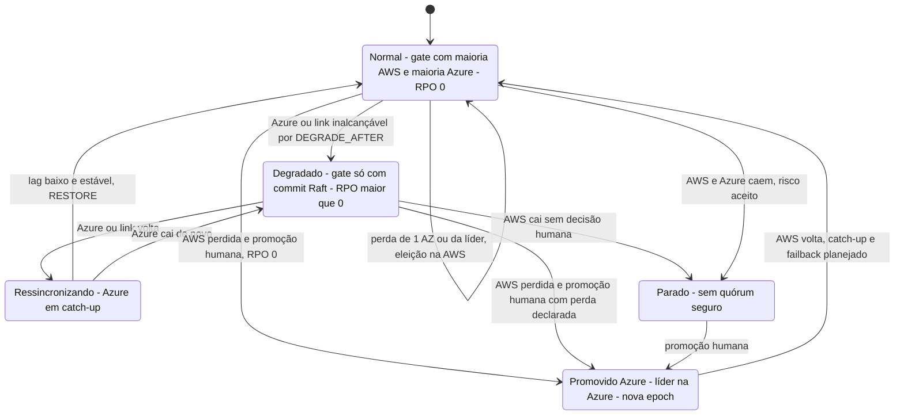

# C17 — Máquina de estados dos modos de operação de um shard

**Status:** ✅ Atualizado (modelo v1) · **ADRs:** [ADR-014](../../03_adr/ADR-014-modo-degradado-opcao-b.md), [ADR-033](../../03_adr/ADR-033-promocao-da-azure-humana.md)

## Cenário

Como o shard transita entre os modos. A entrada em degradado é automática (`DEGRADE`); a volta ao normal exige ressincronização e `RESTORE`; a promoção da Azure é **sempre humana** enquanto PEND-01 estiver aberta. A perda simultânea das duas nuvens é risco aceito.

## Diagrama

## Etapas

1. Início em **Normal**: gate com as duas maiorias, RPO 0.
2. Perda de uma AZ ou da líder mantém o shard em Normal (eleição na AWS).
3. Azure ou link inalcançável por `DEGRADE_AFTER` leva a **Degradado**.
4. A volta da Azure leva a **Ressincronizando**; lag baixo e estável e `RESTORE` levam a Normal.
5. Perda da AWS com promoção humana leva a **Promovido Azure** (RPO 0 se vinha de Normal; perda declarada se vinha de Degradado).
6. **Parado** só sai por promoção humana.

## Pontos em aberto

- A transição Normal → Degradado ainda precisa do modelo TLA+ ([ADR-030](../../03_adr/ADR-030-verificacao-formal-tla.md)).
