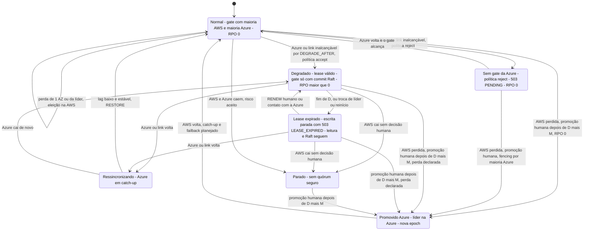

# C17 — Máquina de estados dos modos de operação de um shard

**Status:** ✅ Atualizado (modelo v1, revisão crítica de 13/10/2026) · **ADRs:** [ADR-014](../../03_adr/ADR-014-modo-degradado-opcao-b.md), [ADR-044](../../03_adr/ADR-044-lease-do-modo-degradado-e-promocao-da-azure.md), [ADR-045](../../03_adr/ADR-045-politica-de-degradacao-por-instalacao.md), [ADR-033](../../03_adr/ADR-033-promocao-da-azure-humana.md) · **Relacionados:** [C32](C32-particao-e-lease-do-modo-degradado.md), [C12](C12-modo-degradado.md)

## Cenário

Como o shard transita entre os modos. Com `DEGRADED_POLICY=accept`, a entrada em degradado é automática (`DEGRADE`, com validade D) e **termina sozinha** em escrita parada quando o lease vence (`503 LEASE_EXPIRED`); só uma pessoa prorroga (`RENEW`). Com `reject` não existe degradado: sem o gate da Azure a escrita fica em `503 PENDING`. A volta ao normal exige ressincronização e `RESTORE`. A promoção da Azure é **sempre humana** e só é aceita depois de D + M desde o último contato com a AWS (a API `ForcePromote` recusa antes). A perda simultânea das duas nuvens é risco aceito.

## Diagrama

## Etapas

1. Início em **Normal**: gate com as duas maiorias, RPO 0.
2. Perda de uma AZ ou da líder mantém o shard em Normal (eleição na AWS).
3. Azure ou link inalcançável por `DEGRADE_AFTER` leva a **Degradado** (política `accept`) ou a **Sem gate** (política `reject`, RPO 0 e escrita em `503 PENDING`).
4. Em **Degradado** a líder confere o lease a cada ACK. D conta desde o último contato com a maioria Azure (`t_c`), não desde a proposta do `DEGRADE`. Ao fim de D, ou quando a líder muda ou o nó reinicia (a líder nova não herda `t_c`), o shard vai a **Lease expirado**: a AWS recusa escrita (`503 LEASE_EXPIRED`), a leitura e o Raft seguem. `RENEW` (só humano) ou um novo contato com a Azure volta a Degradado.
5. A volta da Azure leva a **Ressincronizando**; lag baixo e estável e `RESTORE` levam a Normal. `RESTORE` encerra o degradado e o lease ([C13](C13-ressincronizacao-da-azure.md)).
6. Perda da AWS com promoção humana leva a **Promovido Azure**, depois de D + M desde o último contato (RPO 0 se vinha de Normal ou Sem gate; perda declarada se vinha de Degradado ou Lease expirado).
7. **Parado** só sai por promoção humana, também depois de D + M.

## Pontos em aberto

- As regras de `t_c` e de líder nova são decididas ([ADR-044](../../03_adr/ADR-044-lease-do-modo-degradado-e-promocao-da-azure.md)); as transições Normal → Degradado, Degradado ↔ Lease expirado (`RENEW`) e a promoção ainda precisam do modelo TLA+ ([ADR-030](../../03_adr/ADR-030-verificacao-formal-tla.md)): hipóteses H-DR13 (prorrogação x promoção) e H-DR14 (partição assimétrica).
- A ordem entre `RENEW`, `RESTORE` e o bloqueio da promoção na Azure (`promotion_blocked`) é regra candidata, a provar ([C32](C32-particao-e-lease-do-modo-degradado.md)).
