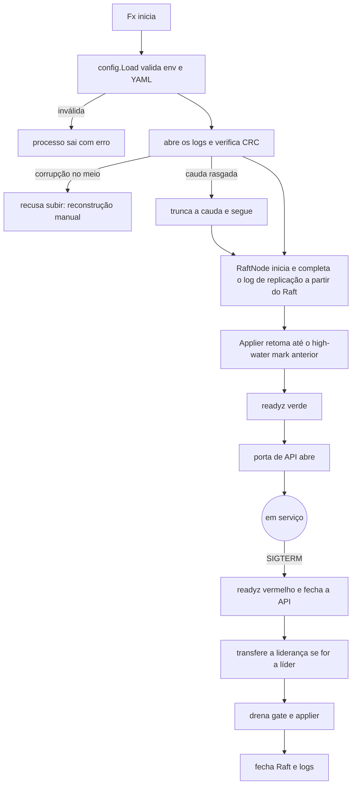
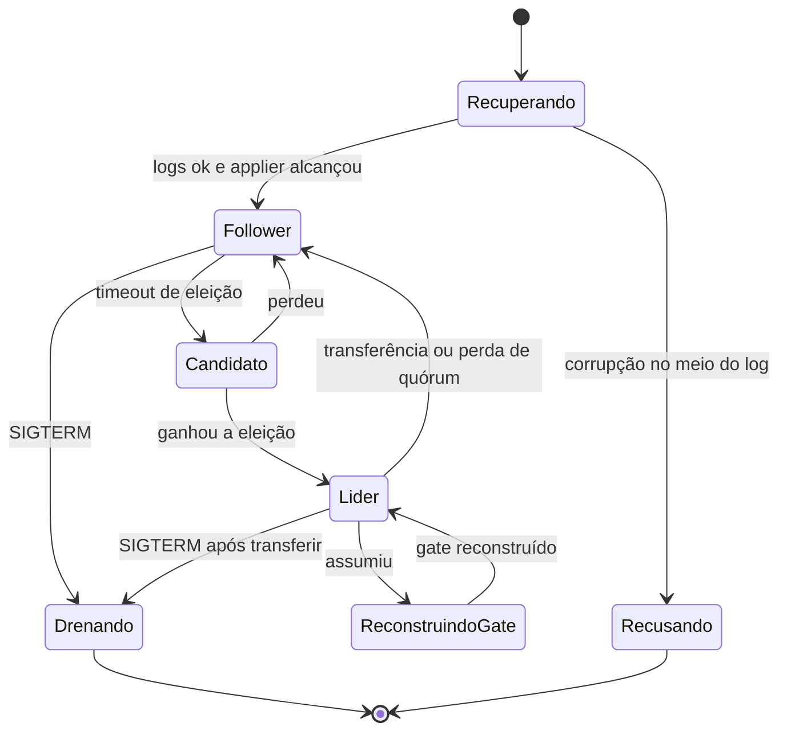

# C18 — Partida, recuperação e parada limpa do nó

**Status:** ✅ Atualizado (modelo v1) · **ADRs:** [ADR-018](../../03_adr/ADR-018-dois-logs-raft-e-replicacao.md), [ADR-019](../../03_adr/ADR-019-wal-proprio-volume-dedicado.md), [ADR-034](../../03_adr/ADR-034-fsync-fatal-e-identidade-nova.md), [ADR-028](../../03_adr/ADR-028-timeouts-em-cascata.md) · **Relacionados:** [X04 Partida e dois logs](../complexos/X04-partida-recuperacao-e-dois-logs.md)

## Cenário

Ao subir, o `DataReplication` valida configuração, abre os logs, completa o log de replicação a partir do Raft, retoma o applier até o último ponto aplicado e só então abre a porta de API. A parada é limpa: fecha a API, transfere a liderança se for a líder, drena e fecha os logs.

## Diagrama: partida e parada

## Diagrama: estados do nó

## Etapas

1. **Configuração:** `CELL_ID`, `WRITE_MODE` e `READ_MODE_DEFAULT` são obrigatórias; chaves desconhecidas no YAML são recusadas; prazos fora de ordem recusam a partida.
2. **Logs:** verifica o CRC; cauda rasgada é truncada; corrupção no meio faz o nó recusar subir.
3. **Completar o log de replicação:** se estiver atrás do índice commitado, é completado a partir do log do Raft antes de aceitar tráfego.
4. **Applier:** retoma até o high-water mark anterior; as leituras fortes só abrem depois (evita ler dado velho e ressuscitar DELETE).
5. **Probes:** `startupProbe` cobre a recuperação; `readinessProbe` não depende de quórum; `livenessProbe` só diz se o loop trava.
6. **Parada:** SIGTERM fecha a API, transfere a liderança, drena com prazo menor que o `terminationGracePeriodSeconds` e fecha os logs.

## Falhas e tratativas

- **Tempo de recuperação longo.** Não quantificado: [R18](../a_rever/R18-rto-nao-quantificado.md).
