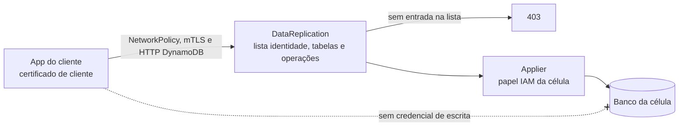

# C20 — Aplicação escreve direto no banco (bypass)

**Status:** ✅ Atualizado (modelo v1, revisão crítica de 13/10/2026) · **ADRs:** [ADR-001](../../03_adr/ADR-001-camada-intermediaria-agnostica.md), [ADR-052](../../03_adr/ADR-052-autorizacao-por-aplicacao-com-mtls.md), [ADR-043](../../03_adr/ADR-043-uma-instalacao-por-cliente-identidade-por-configuracao.md)

## Cenário

Uma escrita direta no DynamoDB ou no Cosmos não passa pelo log: não é replicada e quebra a ordem e o RPO. A regra é que **a aplicação não tem credencial de escrita**; só o applier do `DataReplication` de cada célula escreve (um escritor por tabela por célula).

Fechar o banco para as aplicações cria o problema inverso, que a revisão crítica apontou: o papel largo passa a ser o do `DataReplication`, e se a única barreira for a NetworkPolicy, qualquer pod do namespace escreve em qualquer tabela, o que hoje o IAM por aplicação não permite. Por isso o acesso ao `DataReplication` exige **mTLS por aplicação** e uma lista identidade → tabelas e operações ([ADR-052](../../03_adr/ADR-052-autorizacao-por-aplicacao-com-mtls.md), [C34](C34-autorizacao-por-aplicacao.md)).

## Diagrama

## Etapas

1. O IAM da célula só concede escrita nas tabelas da célula ao papel do `DataReplication`.
2. As apps recebem apenas o endpoint do `DataReplication` e o certificado de cliente da sua identidade.
3. O `DataReplication` autentica pelo certificado (mTLS) e autoriza pela lista: tabela lógica e operação por identidade. Sem entrada, `403`.
4. Leitura direta no Cosmos também é proibida (a camada respeita o `appliedIndex`); reforçar por permissão.

## Falhas e tratativas

- **Pod do namespace sem certificado ou com certificado de outra aplicação.** Sem certificado, o handshake falha; com o certificado de outra identidade, vale a lista dela. A NetworkPolicy continua sendo a primeira barreira.
- **Escrita direta detectada por auditoria.** O bypass não é impedido pela camada, só por IAM; a auditoria do provedor (CloudTrail, log de atividade do Cosmos) alerta escrita fora do papel do `DataReplication`.

## Pontos em aberto

- Autenticação e IAM detalhados: [C31](C31-implantacao-por-cliente-e-identidade.md); lista de permissões e rotação de certificados: [C34](C34-autorizacao-por-aplicacao.md).
