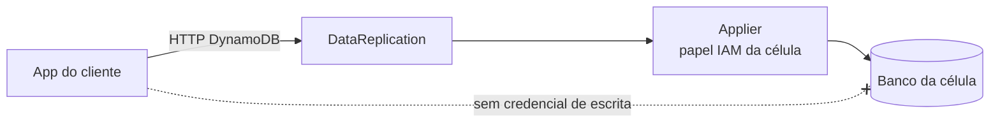

# C20 — Aplicação escreve direto no banco (bypass)

**Status:** ✅ Atualizado (modelo v1) · **ADRs:** [ADR-001](../../03_adr/ADR-001-camada-intermediaria-agnostica.md)

## Cenário

Uma escrita direta no DynamoDB ou no Cosmos não passa pelo log: não é replicada e quebra a ordem e o RPO. A regra é que **a aplicação não tem credencial de escrita**; só o applier do `DataReplication` de cada célula escreve (um escritor por tabela por célula).

## Diagrama

## Etapas

1. O IAM da célula só concede escrita nas tabelas da célula ao papel do `DataReplication`.
2. As apps recebem apenas o endpoint do `DataReplication`.
3. Leitura direta no Cosmos também é proibida (a camada respeita o `appliedIndex`); reforçar por permissão.

## Pontos em aberto

- Autenticação e IAM detalhados: [C31](C31-implantacao-por-cliente-e-identidade.md).
