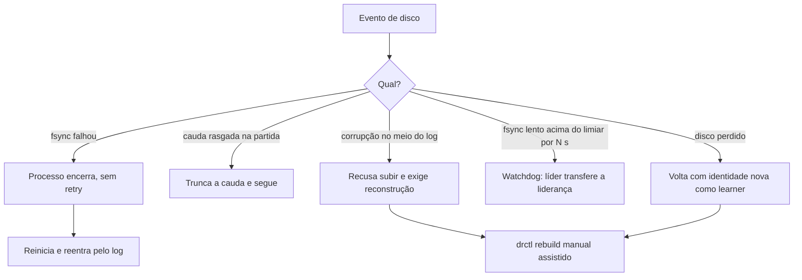

# C21 — Falha de fsync, corrupção, disco lento e disco perdido

**Status:** ✅ Atualizado (modelo v1) · **ADRs:** [ADR-019](../../03_adr/ADR-019-wal-proprio-volume-dedicado.md), [ADR-034](../../03_adr/ADR-034-fsync-fatal-e-identidade-nova.md) · **Relacionados:** [04_wal_e_fsync](../../01_arquitetura/04_wal_e_fsync.md)

## Cenário

O disco é o ponto mais sensível: o fsync decide a latência e a segurança do ACK. A política é de falhar rápido e reconstruir, nunca de seguir com dado duvidoso.

## Diagrama

## Etapas

1. **fsync falhou:** o processo encerra (retry de fsync pode confirmar dado que não está no disco).
2. **Cauda rasgada:** é um registro parcial no fim do segmento; é truncado na partida.
3. **Corrupção no meio:** o nó recusa subir e a réplica é reconstruída.
4. **Disco lento:** um watchdog mede o fsync; acima do limiar por N segundos, a líder transfere a liderança.
5. **Disco perdido:** volta com **identidade nova**, como learner. Nunca reusar o ID antigo com log vazio: o nó pode já ter votado e confirmado entradas.

## Pontos em aberto

- Reconstrução automática (H-DR1): [R23](../a_rever/R23-hipoteses-gerais.md).
- P99 de fsync por tipo de volume: spike S1.
