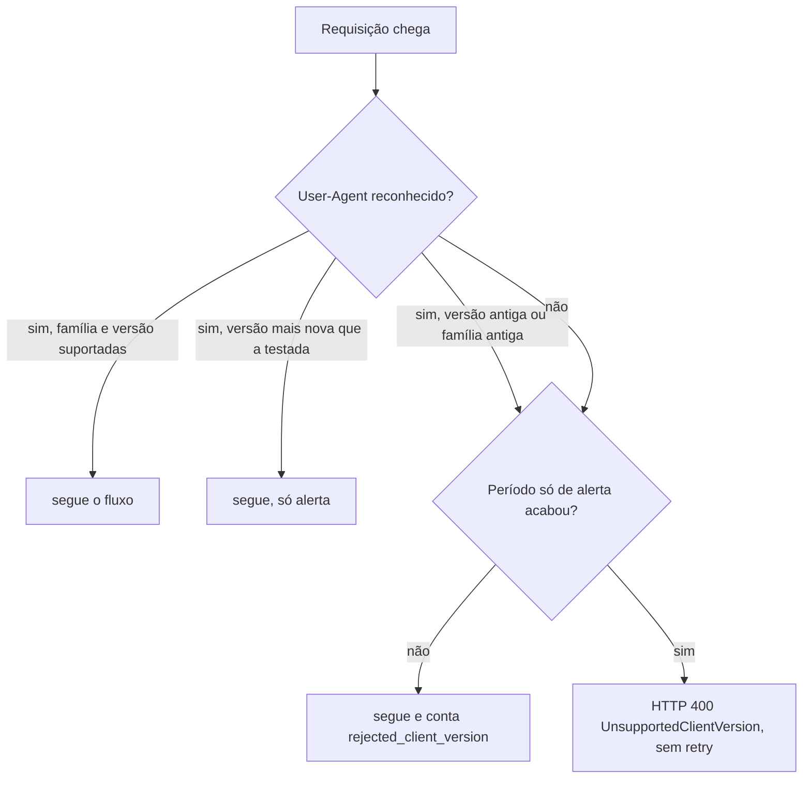

# C22 — Cliente com SDK ou versão não suportada

**Status:** ✅ Atualizado (modelo v1) · **ADRs:** [ADR-025](../../03_adr/ADR-025-escopo-da-api-v1-e-sdks.md)

## Cenário

Só são aceitos AWS SDK Java 2.x, Go v2 e .NET v4. A versão é identificada pelo `User-Agent` (proteção contra configuração errada, **não segurança**). Há um período de 2 a 4 semanas só com alerta; depois, o desconhecido é rejeitado com HTTP 400 não retentável.

## Diagrama

## Etapas

1. Casar o `User-Agent` por trecho, não por igualdade (frameworks acrescentam texto).
2. Go: o "v2" está no nome do módulo; os números de versão do v2 são 1.x. A regra casa pela família.
3. .NET: o pacote `AWSSDK.DynamoDBv2` tem "v2" no nome por causa da API do DynamoDB; vale somente a geração v4 do SDK.
4. A métrica `rejected_client_version{sdk,version}` mostra quem ainda usa versão antiga antes da regra ativar.

## Pontos em aberto

- Suíte de compatibilidade com os três SDKs (X3) contra o `DataReplication` e contra o DynamoDB real.
