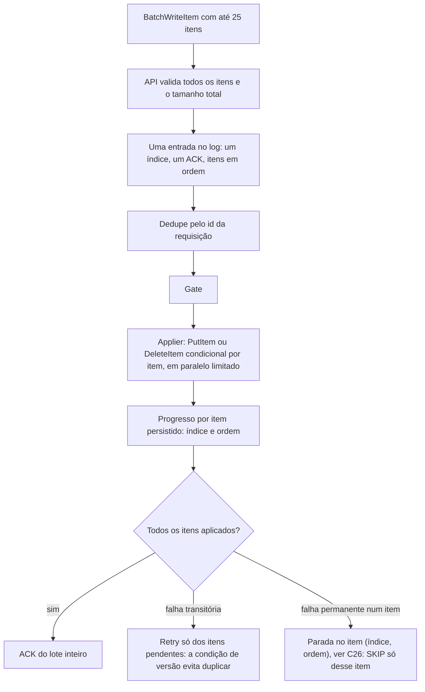

# C23 — BatchWriteItem: o lote é uma entrada e o apply é por item (antes R15)

**Status:** ✅ Atualizado (decidido pelo Bruno em 13/10/2026) · **ADRs:** [ADR-035](../../03_adr/ADR-035-lote-batchwriteitem-uma-entrada-e-apply-condicional.md), [ADR-015](../../03_adr/ADR-015-wal-post-image-e-versao.md), [ADR-026](../../03_adr/ADR-026-dedupe-de-retry-id-estavel.md), [ADR-048](../../03_adr/ADR-048-skip-por-item.md), [ADR-025](../../03_adr/ADR-025-escopo-da-api-v1-e-sdks.md) · **Relacionados:** [C07](C07-timeout-depois-do-commit.md), [X05](../complexos/X05-timeouts-e-idempotencia.md), [C03](C03-escrita-strong.md), [C26](C26-entrada-venenosa.md)

## Cenário

O `BatchWriteItem` carrega até **25 itens**, cada um com a sua tabela. Se o lote virasse 25 entradas, cada uma com índice e ACK próprios, uma falha da líder no meio expõe parte do lote. Além disso, o `BatchWriteItem` do DynamoDB **não aceita `ConditionExpression`**, e o applier depende da condição de versão (`v < índice`) para o replay ser idempotente.

## Decisão

1. O lote vira **uma entrada** (um índice, um ACK). A versão de todos os itens é o mesmo índice.
2. O applier grava com **`PutItem`/`DeleteItem` condicionais por item**, em paralelo limitado a 25 por entrada. Item já aplicado devolve `ConditionalCheckFailed` e conta como "já aplicado".
3. O ACK só sai com **todos** os itens aplicados na célula da líder.
4. O applier persiste o **progresso por item**, `(índice, ordem)`, no volume do log, e a consulta por identificador da requisição devolve o resultado **por item**: `APPLIED`, `REJECTED` ou `PENDING` ([ADR-048](../../03_adr/ADR-048-skip-por-item.md)).

## Diagrama: lote como uma entrada, apply por item

## Etapas

1. **Validação:** todos os itens e o tamanho total do lote são validados antes do commit. Lote acima do limite de entrada (4 MiB) é recusado com erro 4xx definido.
2. **Uma entrada:** o lote entra no log com itens em ordem. Chaves repetidas no lote já são recusadas pelo DynamoDB, então não há ambiguidade.
3. **Dedupe:** por **requisição** (não por item), pelo identificador estável da requisição inteira. A nova tentativa de `UnprocessedItems` é feita pela aplicação com **outro** id e vale como nova escrita idempotente pela versão. Como o ACK só sai com todos os itens aplicados, a resposta não devolve `UnprocessedItems`.
4. **Apply:** por item, condicional. No Cosmos, o Cloud-Adapter aplica por item também (o lote transacional do Cosmos só vale dentro da mesma partition key).
5. **ACK** depois do gate e de todos os itens aplicados na célula da líder.
6. **Consulta por item:** a consulta por identificador devolve o estado de cada item. Um item pulado por `SKIP` aparece `REJECTED` e os demais `APPLIED`, como o sucesso parcial do `BatchWriteItem` real.

## Falhas e tratativas

- **Leitor vê o lote pela metade.** Durante o apply, como já ocorre no DynamoDB, que não promete atomicidade em `BatchWriteItem`.
- **Lote acima de 4 MiB.** O DynamoDB aceitaria até 16 MB; o `DataReplication` recusa antes do commit. O cliente com itens grandes precisa saber, e o erro deve dizer o limite.
- **Latência do apply.** Até 25 gravações condicionais por entrada, em vez de uma chamada de lote: mais chamadas e P99 maior no Strong ([C24](C24-orcamento-de-50ms-e-escrita-no-dynamodb.md)).
- **Custo.** As unidades de gravação são as mesmas do lote; muda o número de chamadas ([R20](../a_rever/R20-custo-6x.md)).
- **Falha permanente de um item.** Trava o shard como em [C26](C26-entrada-venenosa.md); a validação pré-commit cobre todos os itens. O `SKIP` identifica `(índice, ordem)` e **pula só o item ruim**: os demais itens do lote, aplicados antes ou depois, são mantidos.
- **Falha da líder no meio do apply.** A nova líder reaplica a entrada; os itens já aplicados devolvem `ConditionalCheckFailed` e são tratados como feitos. O progresso por item no volume do log evita reaplicar o que já consta como `APPLIED`, mas a condição de versão continua sendo a garantia.

## Pontos em aberto

- Confirmar no spike S5, com o DynamoDB real, que `BatchWriteItem` recusa condição e medir o P99 do apply de 25 itens.
