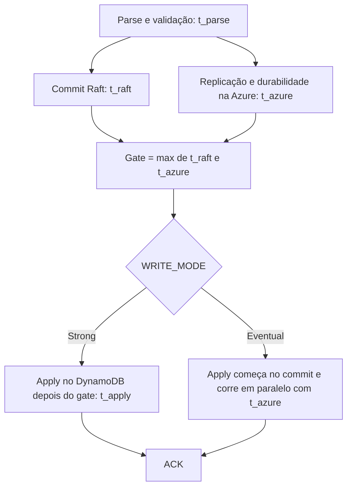

# C24 — Orçamento de 50 ms e a escrita no DynamoDB dentro do ACK (antes R21)

**Status:** ✅ Atualizado (decidido pelo Bruno em 13/10/2026) · **ADRs:** [ADR-036](../../03_adr/ADR-036-slo-de-50ms-exclui-a-escrita-no-banco.md), [ADR-005](../../03_adr/ADR-005-ack-exige-gate.md), [ADR-023](../../03_adr/ADR-023-modos-de-escrita-e-leitura.md) · **Relacionados:** [C03](C03-escrita-strong.md), [C04](C04-escrita-eventual.md), [C07](C07-timeout-depois-do-commit.md)

## Cenário

A meta de **overhead P99 ≤ 50 ms** não inclui a escrita no DynamoDB. Só que o ACK sai depois do apply na célula da líder (6.9, item 4): o tempo de escrita no DynamoDB, **com a cauda dele**, está no caminho do ACK. O cliente enxerga `overhead + escrita no banco`, e uma limitação de vazão do DynamoDB (partição quente, throttling) bloqueia o ACK.

## Decisão

O SLO de 50 ms **continua excluindo** a escrita no DynamoDB e passa a ser **publicado como `overhead + banco`**, com o P99 do banco como parte do contrato com o cliente.

## Diagrama: o que entra no caminho do ACK

## Etapas

1. **Strong:** `t_ack = t_parse + max(t_raft, t_azure) + t_apply + t_resp`.
2. **Eventual:** `t_ack = t_parse + max(t_azure, t_raft + t_apply) + t_resp`.
3. **Overhead medido** = `t_ack − t_apply` no Strong; no Eventual o `t_apply` fica escondido atrás da Azure.
4. **Contrato com o cliente:** a latência que ele vê é `overhead + escrita no banco`; o P99 do DynamoDB faz parte dela.
5. As quatro parcelas são métricas separadas (`t_parse`, `t_raft`, `t_azure`, `t_apply`).

## Falhas e tratativas

- **Cauda do DynamoDB.** O P99 de `PutItem` condicional é de poucos ms, mas a cauda (retries internos, throttling em partição quente) pode passar de 50 ms e aparece inteira no ACK.
- **Throttling vira PENDING.** Se o DynamoDB devolve throttling por mais que o prazo (7,5 s), a escrita commitada responde `503 PENDING` e o applier segue tentando ([C07](C07-timeout-depois-do-commit.md)).
- **ACK antes do apply** reduziria a latência, mas quebra a leitura-do-que-escrevi da leitura forte local e reabre o ADR-023. Descartado.
- **Várias escritas por transação do cliente.** Com 3 ou mais escritas sequenciais por transação de negócio, o alvo de 150 ms por transação não fecha mesmo com o overhead dentro de 50 ms (PEND-07).

## Pontos em aberto

- Medir `t_parse`, `t_raft`, `t_azure` e `t_apply` separadamente no spike S1 para fechar o orçamento.
- PEND-07: número de escritas sequenciais por transação.
